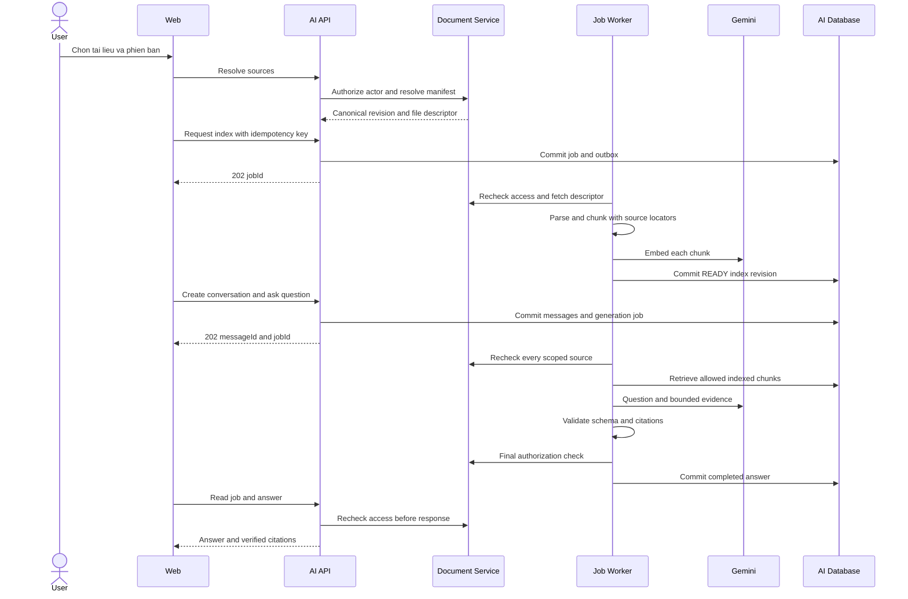
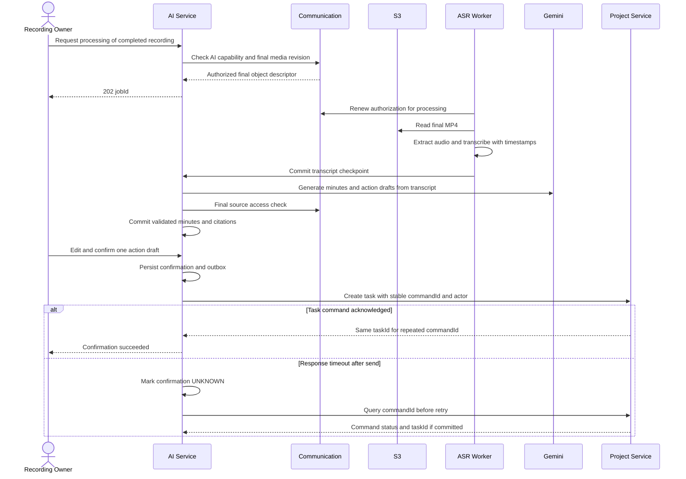
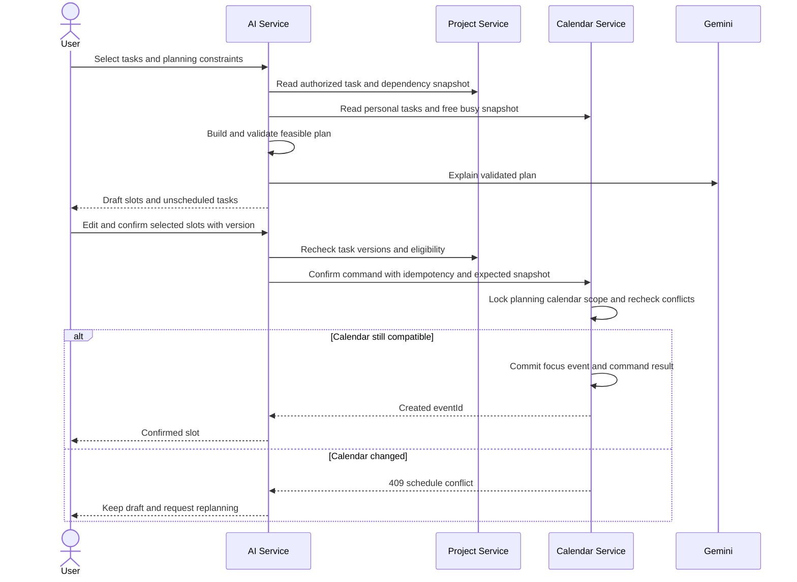
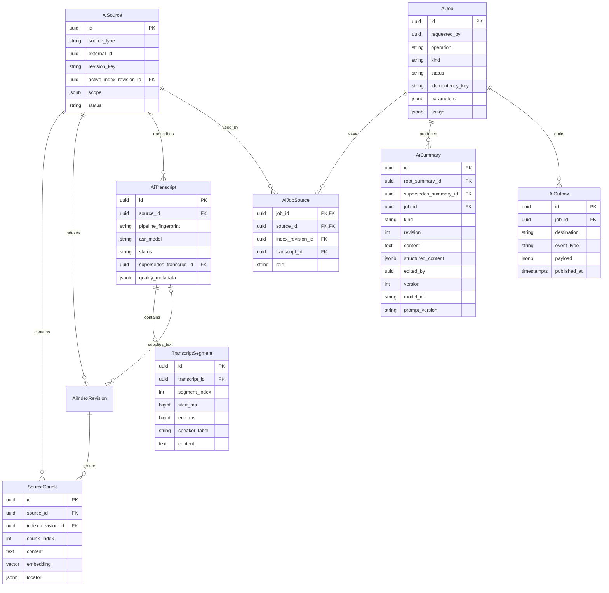
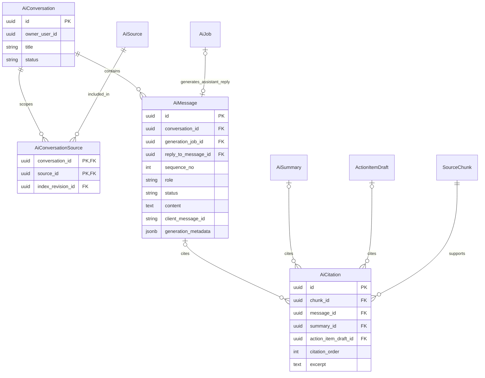
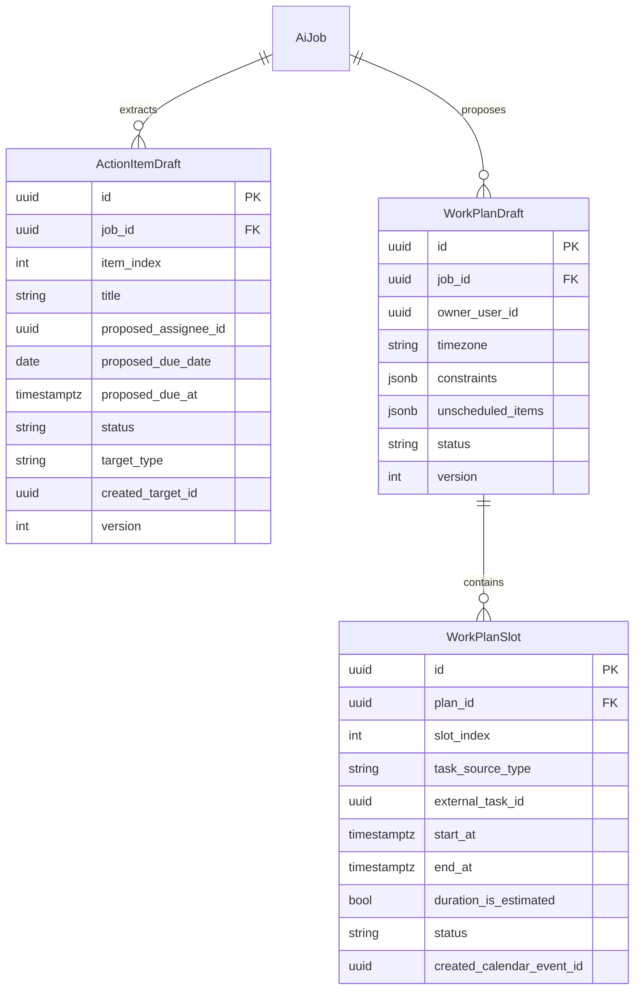
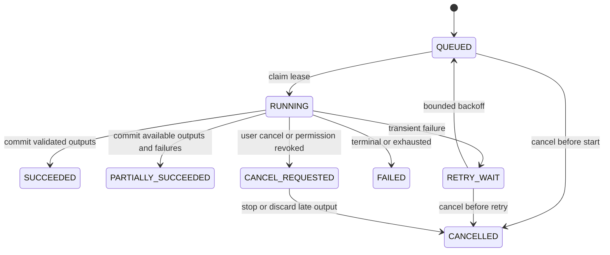
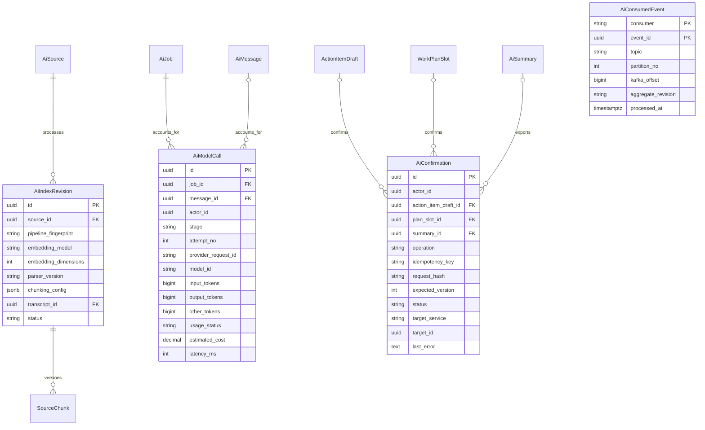
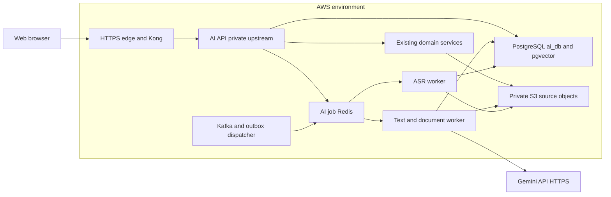

# Thiết kế và kế hoạch triển khai AI Service — WorkSpaceHub

Ngày lập: 15/10/2026. Trạng thái: đề xuất, chưa triển khai. Các checkbox dưới đây là công việc dự kiến.

**Đã xác nhận với người dùng:** triển khai trên AWS và sử dụng Gemini API. Tài liệu này hợp nhất phạm vi sản phẩm, kết quả rà soát repository, kiến trúc, ERD, contract API, vận hành và tiêu chí nghiệm thu. Những thông số ghi “khởi điểm” là đề xuất để đo, chưa phải kết quả benchmark hoặc cấu hình AWS đang chạy.

## Mục lục

- [1. Mục tiêu và phạm vi](#section-1)
- [2. Công nghệ đề xuất](#section-2)
- [3. Kiến trúc và trách nhiệm](#section-3)
- [4. Pipeline xử lý, đọc document (4.6) và lệnh @summary trong nhóm (4.7)](#section-4)
- [5. Dữ liệu, API và vị trí thay đổi dự kiến](#section-5)
- [6. Lộ trình và tiêu chí nghiệm thu](#section-6)
- [7. Chất lượng, chi phí và vận hành](#section-7)
- [8. Thông tin cần chốt trước khi triển khai](#section-8)
- [9. Contract API công khai](#section-9)
- [10. Contract nội bộ và sự kiện](#section-10)
- [11. Ma trận phân quyền và nội dung dẫn xuất](#section-11)
- [12. Vòng đời trạng thái và quy tắc retry](#section-12)
- [13. Dữ liệu vận hành bổ sung](#section-13)
- [14. Luồng giao diện và tích hợp frontend](#section-14)
- [15. Phương án triển khai AWS](#section-15)
- [16. Tối ưu hiệu năng và chi phí](#section-16)
- [17. Kiểm thử và nghiệm thu](#section-17)
- [18. Cấu trúc triển khai và checklist thực hiện](#section-18)

<a id="section-1"></a>

## 1. Mục tiêu và phạm vi

Xây dựng `backend/ai-service` dùng chung cho hội thoại, tài liệu, bản ghi cuộc họp và lập kế hoạch làm việc. Tận dụng Kong, PostgreSQL, Redis, Kafka, S3 và frontend hiện có.

| Chức năng | Đầu vào | Kết quả và nguồn kiểm chứng |
| --- | --- | --- |
| Tóm tắt hội thoại | Channel/direct conversation và khoảng tin nhắn được phép đọc | Chủ đề, quyết định, vấn đề còn mở; liên kết tin nhắn |
| Gọi AI trong group chat | Thành viên gửi `@summary` hoặc alias `@sumary` vào channel | Bản tóm tắt từ đầu ngày đến thời điểm gửi lệnh, trả trong nhóm và lưu cùng lịch sử chat |
| Tóm tắt tài liệu | Một phiên bản tài liệu | Tóm tắt ngắn, ý chính, tham chiếu trang/mục |
| Hỏi đáp một/nhiều tài liệu | Câu hỏi, danh sách tài liệu được phép đọc | Câu trả lời kèm nguồn theo từng nhận định; nêu rõ khi nguồn mâu thuẫn hoặc thiếu dữ kiện |
| Tóm tắt recording | Bản ghi đã hoàn tất và người dùng có quyền xem | Tóm tắt nội dung lời nói, các mốc đáng chú ý |
| Trích xuất việc cần làm | Hội thoại, tài liệu hoặc transcript | Task đề xuất, người phụ trách/deadline nếu được nêu rõ, nguồn gốc |
| Hỏi đáp recording | Câu hỏi và transcript | Câu trả lời kèm timestamp mở đúng đoạn video |
| Tạo biên bản cuộc họp | Transcript, thông tin cuộc họp, chat liên quan nếu có quyền | Bản nháp có thể sửa: chủ đề, quyết định, việc cần làm, vấn đề chưa chốt |
| Gợi ý kế hoạch làm việc | Task cá nhân/dự án, lịch bận, thời lượng và ưu tiên | Lịch đề xuất có giải thích, danh sách việc chưa xếp được |

MVP đi theo thứ tự: hội thoại và action items → tài liệu và hỏi đáp → recording và biên bản → kế hoạch làm việc. Phân tích hình ảnh/slide trong video, trợ lý tự thao tác nhiều bước và huấn luyện model riêng là phần mở rộng.

### 1.1. Hiện trạng đã đối chiếu trong repository

Đã lập chỉ mục và quét các file nguồn/cấu hình/tài liệu ở toàn bộ module; đọc sâu controller, policy, service, schema, worker và frontend adapter liên quan đến AI. Lượt kiểm kê gồm 1.368 file, khoảng 155.897 dòng theo bộ lọc đã dùng, loại dependencies/build artifacts và lockfile. Số liệu này là phạm vi quét, không có nghĩa đã kiểm chứng mọi dòng hoặc chạy toàn bộ hệ thống. Không đọc file secret `.env` hay thông tin xác thực AWS để lập kế hoạch.

| Module hiện có | Khả năng tái sử dụng | Khoảng trống liên quan đến AI |
| --- | --- | --- |
| User, Java 21/Spring Boot 4.1 | JWT, email, account language/timezone, profile bulk | Worker cần xác minh user còn hoạt động mà không lưu access/refresh token dài hạn |
| Project, NestJS/Prisma | Task, assignee, dependency, quyền tạo/sửa theo thành viên, notification outbox | Thêm delegated command có idempotency, snapshot task cho planning |
| Communication, NestJS/Prisma | Space/channel/DM, thread, meeting, recording ownership/sharing | API export snapshot có kiểm tra người đọc; sự kiện thay đổi nguồn bền vững |
| Document, NestJS/Prisma/S3 | Upload trực tiếp S3, quyền kế thừa folder, version, archive, share | Manifest đúng phiên bản; sự kiện source/ACL; chưa có parser/RAG |
| Calendar, NestJS/Prisma | Task cá nhân, recurrence, lịch, reminder, Pomodoro | Free/busy snapshot và thao tác ghi lịch có idempotency/kiểm tra xung đột |
| Notification, NestJS/PostgreSQL | `notification-topic`, Socket.IO, push, renderer registry | Chưa có enum/consumer cho AI; cần dedup completion và không gửi nội dung nhạy cảm qua push |
| Caption, Python/WhisperLiveKit | Đã có faster-whisper, cấu hình CPU/GPU và nhận dạng tiếng Việt | Chưa lưu transcript; không dùng worker live để xử lý recording dài |
| Web, Next.js 16/React 19 | Axios refresh token, TanStack Query, Redux, các feature sẵn có | `/ai` mới là trang khung; cần AI panel và deep link đến nguồn |
| Kong/Docker/LiveKit | Routing, JWT context, correlation ID, health, recording MP4 | Chưa có route/health/profile AI; compose hiện có cấu hình development |

### 1.2. Các chi tiết hiện có phải giữ đúng khi tích hợp

1. Document version đầu có thể là giá trị tổng hợp `original`, chưa có UUID trong `DocumentVersion`; lấy qua adapter nguồn, không ép mọi version ID thành UUID.
2. Document permission kế thừa từ folder và còn phụ thuộc share/link/expiry/archive. `projectId` hoặc kết quả `getPermissionRole` đơn lẻ không đủ để cấp quyền AI.
3. API đọc channel/DM hiện có các nhánh không nhận danh tính người đọc; không dùng nguyên trạng làm cơ sở bảo đảm quyền. API export dành cho AI phải kiểm tra membership ở service nguồn và chốt quy tắc lịch sử trước/sau khi gia nhập.
4. Meeting chat hiện yêu cầu participant đã join; sở hữu recording không mặc nhiên cấp quyền đọc meeting chat. Biên bản từ recording không tự thêm chat cuộc họp.
5. Recording phân biệt `canView`, `canDownload`, owner và quyền chia sẻ. AI processing là năng lực cần định nghĩa riêng, không suy từ quyền tải hoặc từ việc từng tham gia cuộc họp.
6. Recording worker đã ghép các segment thành MP4 cuối cùng; ASR đọc MP4 hoàn tất để timestamp trùng player, tránh tự ghép lần hai.
7. Calendar `EventSourceType.TASK` là task cá nhân; chưa phải project task đồng bộ. Deadline cá nhân hiện được frontend mã hóa bằng `[TASK]` và `[Deadline: ...]` trong description; không lấy `endAt` làm deadline.
8. `CreateTaskDto` nhận `assigneeUserId`, task title tối đa 200 ký tự; Calendar create yêu cầu calendar/start/end và description tối đa 2.000 ký tự. AI phải map theo các DTO thật.
9. Notification enum hiện không có `SYSTEM`, `AI_JOB_COMPLETED` hay `AI_JOB_FAILED`. Thêm enum, consumer và frontend mapping trước khi phát loại mới.
10. Kong có CORS cho `Idempotency-Key` và payload limit 10 MB. AI nhận ID nguồn; file lớn đi S3, không tăng payload limit toàn hệ thống chỉ để phục vụ AI.

### 1.3. Phạm vi phát hành

| Mốc | Có thể sử dụng | Giới hạn có chủ đích |
| --- | --- | --- |
| R1 | Tóm tắt channel/DM theo phạm vi; lệnh `@summary` trong channel; action items và xác nhận tạo project task | Kết quả từ AI panel riêng tư; lệnh trong nhóm chủ động tạo bản tóm tắt dùng chung theo policy mục 4.7; chưa tự tạo task |
| R2 | Tóm tắt PDF/DOCX; hỏi đáp một/nhiều tài liệu với citations | Folder được bung thành danh sách file đã chốt; scan/PPTX chỉ bật khi parser đạt kiểm thử |
| R3 | Transcript recording hoàn tất, tóm tắt, biên bản và hỏi đáp timestamp | Nội dung lời nói; không hứa nhận diện chính xác tên người nói từ audio trộn |
| R4 | Gợi ý kế hoạch, xác nhận từng slot vào lịch cá nhân | Một người dùng; chưa tự tối ưu lịch của cả nhóm |

Thông báo hoàn thành và quota là khả năng nền, phát triển cùng các mốc. Không đợi triển khai đủ 19 bảng mới trình diễn R1.

### 1.4. Kết luận rà soát tính phù hợp và mức tối ưu

**Kết luận:** phù hợp để triển khai theo từng mốc; chưa có bằng chứng để gọi là phương án nhanh nhất/rẻ nhất hoặc ERD tối ưu tuyệt đối. Tài liệu là baseline có thể thực hiện, các quyết định tối ưu vật lý phải được xác nhận bằng workload thật và EXPLAIN/benchmark trên AWS.

| Phần đánh giá | Quyết định sau rà soát | Giới hạn cần hiểu đúng |
| --- | --- | --- |
| Python/FastAPI | Giữ vì pipeline có tài liệu, ASR và planning; đã có Python ở caption-service | Không khẳng định Python làm Gemini trả lời nhanh hơn NestJS; nếu chỉ gọi SDK, NestJS cũng đáp ứng được |
| Gemini + SDK chính thức | Giữ đúng lựa chọn người dùng; cấu hình model và schema theo từng tác vụ | Chốt model bằng bộ mẫu/quota thật, không chọn chỉ vì mới nhất |
| PostgreSQL/pgvector | Giữ; đủ khả năng triển khai dữ liệu liên quan, provenance và retrieval ban đầu | Index/vector parameters phải đo; không thêm HNSW/GIN cho mọi cột ngay |
| Celery/Redis + Kafka | Celery chạy job nội bộ; Kafka nhận/phát sự kiện liên service hiện có | Không dùng Kafka và Celery để thực thi trùng một job; không mở thêm broker ở R1 |
| Docling và faster-whisper | Giữ làm worker theo nhu cầu R2/R3 | Không load model OCR/ASR trong API; ASR CPU/GPU chưa chốt hiệu năng khi chưa đo |
| AWS | Theo EC2/Compose hiện có nếu đó là môi trường thật, mở rộng managed services khi cần | Không mặc định phải có ECS, GPU, RDS cluster mới hoặc Redis managed mới |
| ERD | 19 bảng cho toàn bộ chức năng; bổ sung `AiTranscript` để tách phiên bản ASR khỏi chỉ mục embedding | Số bảng không phải tiêu chí tối ưu; tạo theo release, không triển khai full scope trước R1 |

Các chỉnh sửa quan trọng sau rà soát: gắn assistant message với generation job bằng FK; quản lý transcript và segment bằng FK/version riêng; giữ structured content làm nguồn dữ liệu chuẩn; chặn confirmation tạo task/slot trùng ở cả SENT/UNKNOWN; đối soát job không chỉ từ outbox đã publish; quy định query/index theo đường đọc thật tại mục 13.3–13.4.

Sau khi thêm lệnh nhóm, rà soát thêm retry hỏi đáp và delivery: mỗi câu trả lời ghim câu hỏi/job riêng, command nhóm có deadline/đối soát và không được tạo job mới qua nút retry chung. Phạm vi công nghệ giữ nguyên; chưa có căn cứ để thêm framework agent, vector database riêng hoặc GPU cho R1.

**Chốt thiết kế sau lượt rà soát cuối:** đủ phạm vi và mức chi tiết để bắt đầu R1; lệnh chat tại mục 4.7 dùng lại các bảng AI hiện có, bổ sung command/outbox ở Communication. Đã đối chiếu tĩnh các luồng với code nguồn; migration/contract, chất lượng Gemini, chi phí và khả năng chịu tải vẫn phải qua kiểm thử ở mục 17. Các thông số vận hành chưa xác nhận được tập trung tại mục 18.5, không coi là yêu cầu đã chốt.

<a id="section-2"></a>

## 2. Công nghệ đề xuất

| Thành phần | Lựa chọn | Cách áp dụng |
| --- | --- | --- |
| Ngôn ngữ/API | Python 3.12, FastAPI, Pydantic | Một codebase; tách tiến trình API và worker; ghim phiên bản sau khi kiểm tra tương thích |
| Dữ liệu | PostgreSQL + pgvector | Database `ai_db` riêng; dùng chung PostgreSQL instance ban đầu nếu tài nguyên cho phép |
| ORM/migration | SQLAlchemy + Alembic | Quản lý schema AI; không sửa trực tiếp database của service khác |
| Tác vụ nền | Celery + Redis | Parse/OCR, embedding, speech-to-text, tóm tắt dài; lưu trạng thái nghiệp vụ trong PostgreSQL |
| Sự kiện | Kafka hiện có | Sự kiện liên service; Celery điều phối job nội bộ AI |
| Đọc tài liệu | Docling | Trích xuất cấu trúc, bảng, vị trí nguồn; chỉ bật OCR khi cần, đo chất lượng tiếng Việt |
| Recording | FFmpeg + faster-whisper | Tách audio, nhận dạng theo đoạn có timestamp; cấu hình model theo RAM/VRAM |
| LLM | Gemini Flash stable qua Gemini Developer API | SDK Python `google-genai`; model ID bắt buộc qua cấu hình; preflight tài khoản và đánh giá trước khi ghim |
| Embedding | Gemini embedding, baseline text-only `gemini-embedding-001`, 768 chiều | `RETRIEVAL_DOCUMENT`/`RETRIEVAL_QUERY`, chuẩn hóa vector; so sánh embedding mới bằng cùng bộ mẫu trước khi chuyển |
| Lập lịch | Thuật toán theo luật; OR-Tools CP-SAT khi cần | LLM diễn giải yêu cầu; bộ lập lịch kiểm tra ràng buộc |
| Frontend | Next.js, Axios, TanStack Query hiện có | Poll trạng thái job trước; stream câu trả lời bằng SSE khi cần |
| Đóng gói/kiểm thử | Docker Compose, pytest, Ruff | Worker chạy container Linux trên máy Windows; kiểm chứng với backend thật |

Đây là lựa chọn khởi đầu theo stack hiện tại, chưa phải kết luận benchmark. Người dùng đã chọn AWS và Gemini API; không cần tự host LLM hoặc thêm Bedrock/SageMaker để thực hiện các chức năng này. Chưa cần vector database độc lập hoặc framework agent; bổ sung khi đo đạc cho thấy cần thiết. Không lấy hạn mức miễn phí làm giả định vận hành.

### 2.1. Quyết định công nghệ và phương án thay thế

| Quyết định | Lý do áp dụng | Chỉ đổi khi |
| --- | --- | --- |
| Một service Python, API/worker tách tiến trình | Dùng chung parser, ASR, schema và thuật toán; scale tài nguyên độc lập | Có bottleneck hoặc đội phát triển cần sở hữu subsystem riêng |
| Gọi thẳng Google GenAI SDK | Dễ đo request, timeout, token, schema; ít abstraction | Pipeline cần orchestration có lưu checkpoint mà code hiện tại khó quản lý |
| pgvector trên `ai_db` | Dùng transaction, metadata filter và dữ liệu liên quan trên PostgreSQL | Đo retrieval/chi phí chứng minh cần search engine riêng |
| Celery + Redis cho job; Kafka cho domain event | Phù hợp hạ tầng đã có; phân biệt retry tác vụ với replay sự kiện | Đánh giá vận hành AWS cho thấy SQS phù hợp hơn; không chạy đồng thời hai queue cho cùng nhiệm vụ |
| S3 giữ file, PostgreSQL giữ nội dung xử lý vừa phải | Không chuyển file lớn qua gateway, không sao chép recording mỗi lần hỏi | Cần lưu bản parse lớn ở S3 theo retention riêng |
| ASR batch riêng bằng faster-whisper | Có sẵn kinh nghiệm vận hành, cung cấp timestamp, không chiếm worker CC | CPU không đạt hoặc Gemini audio vượt benchmark chất lượng/chi phí/timestamp |

Google khuyến nghị SDK `google-genai`; structured output hỗ trợ schema nhưng ứng dụng vẫn phải kiểm tra dữ liệu và quyền. [SDK chính thức](https://ai.google.dev/gemini-api/docs/libraries), [Structured Outputs](https://ai.google.dev/gemini-api/docs/structured-output).

Baseline embedding 001 dùng task type phù hợp và chuẩn hóa khi giảm xuống 768 chiều. Nếu thử `gemini-embedding-2`, adapter phải thay cách tạo instruction và batching: API có thể gộp nhiều input thành một embedding, không được giả định một request nhiều chunk luôn trả một vector/chunk. Giữ một vector cho mỗi chunk, kiểm tra số lượng, số chiều và giá trị hữu hạn. [Gemini Embeddings](https://ai.google.dev/gemini-api/docs/embeddings).

Preflight mỗi release kiểm tra model còn được phục vụ, capability/schema, giới hạn input và lịch ngừng hỗ trợ; model stable cũng có thể có shutdown date. Giữ model ID/config trong job và lập lại index khi đổi embedding space, không chỉ đổi tên model trong biến môi trường. [Gemini deprecations](https://ai.google.dev/gemini-api/docs/deprecations).

### 2.2. Cấu hình tối thiểu để bắt đầu, tránh dựng toàn bộ thiết kế

R1 dùng một AI API, một Celery worker text và một dispatcher/reconciler nhẹ, cùng một codebase/image. Có thể chia lane bằng routing trong một worker trước khi tách process theo tải. Chưa khởi động OCR/ASR, Kafka consumer AI, planner hoặc GPU cho tính năng chỉ tóm tắt chat.

| Bắt buộc ở R1 | Bổ sung theo nhu cầu tính năng |
| --- | --- |
| FastAPI/Pydantic, SQLAlchemy/Alembic, Google GenAI SDK, HTTP client, JWT verification | Docling ở R2; faster-whisper/FFmpeg ở R3; OR-Tools khi planning heuristic không đạt |
| PostgreSQL cho job/source/provenance/output và Redis cho Celery | Vector extension/index và embedding API khi bật retrieval R2; không gọi embedding cho mọi chat summary |
| Snapshot chat có authorization; command tạo task có dedup ở Project; command/outbox Communication khi bật `@summary` | Document/recording/planning internal endpoints theo release; không triển khai tất cả endpoint mục 10 trước R1 |
| Job/outbox/lease, usage và confirmation | Kafka inbox/invalidation khi bật domain events; notification sau khi consumer/dedup/auth đáp ứng |

Schema R1 cụ thể: `AiSource`, `AiIndexRevision` chỉ provenance, `SourceChunk`, `AiJob`, `AiJobSource`, `AiSummary`, `AiCitation`, `ActionItemDraft`, `AiOutbox`, `AiModelCall`, `AiConfirmation`. Không tạo bảng conversation/transcript/planning khi chưa dùng. Database vẫn được thiết kế để thêm các mốc sau bằng migration additive.

ERD thể hiện schema cuối cùng; migration R1 chỉ tạo các cột/FK hợp lệ với bảng đã có. Các cột vector, message, transcript và plan-slot liên quan đến mốc sau được thêm cùng mốc đó; thứ tự cụ thể tại mục 13.2. Feature flag không thay thế việc đồng bộ phiên bản code và database.

Không triển khai đồng thời tất cả kênh transport, cloud service và model. Quyết định đổi sang SQS, managed vector search, framework agent hoặc GPU phải có số liệu hoặc yêu cầu vận hành tương ứng; việc một công nghệ mới hơn không tự làm nó phù hợp hơn với project này.

<a id="section-3"></a>

## 3. Kiến trúc và trách nhiệm

```text
Frontend → Kong → AI API → PostgreSQL/pgvector
                    │
                    ├── API nội bộ → Document / Communication / Project / Calendar
                    └── Celery qua Redis → AI Worker → Parser / ASR / Model API

Sự kiện nguồn → Kafka consumer → tạo job bền vững → AI Worker
Job hoàn tất → outbox → Kafka → Notification Service
```

- Service nguồn giữ dữ liệu gốc và quyết định quyền đọc/ghi. AI nhận ID nguồn, tự lấy dữ liệu qua API nội bộ đã xác thực; không tin user ID hoặc quyền do client tự khai.
- Kiểm tra quyền lúc yêu cầu, lúc worker lấy dữ liệu và trước khi trả kết quả. Truy xuất chỉ trong tập nguồn được phép; thu hồi quyền phải chặn cả kết quả AI đã lưu.
- Event chứa ID, phiên bản và loại thay đổi; không đưa toàn bộ tài liệu/audio lên Kafka. Consumer chống trùng theo event ID và chỉ xác nhận sau khi ghi job bền vững.
- Job và outbox ghi cùng transaction; dispatcher đẩy Celery, có cơ chế phục hồi nếu queue lỗi. Worker xử lý idempotent, retry có giới hạn/backoff; quá số lần chuyển trạng thái lỗi có thể chạy lại.
- API trả `202 Accepted` cho tác vụ dài. Tách queue xử lý tài liệu và audio để recording dài không chặn hỏi đáp.

### 3.1. Trình tự xử lý và khả năng phục hồi

1. API xác thực actor → chuẩn hóa payload/tính request hash → tra actor/operation/idempotency key. Key đã có thì so hash, authorize lại đúng nguồn đã ghim rồi trả cùng kết quả/ID; không reserve quota hoặc resolve sang phiên bản mới. Key chưa có mới kiểm tra quota, resolve/authorize nguồn, ghim config/fingerprint và ghi job/reservation/outbox trong transaction. Xử lý race bằng unique/CAS, không chỉ kiểm tra tồn tại trước INSERT. Không giữ transaction DB mở trong lúc gọi Gemini/S3/service khác.
2. Dispatcher claim outbox bằng lease và `FOR UPDATE SKIP LOCKED`, gửi message chỉ chứa job ID. Payload dài nằm DB/S3.
3. Worker nhận job, claim lease bằng compare-and-swap, kiểm tra lại quyền/version và checkpoint. Một job có thể được giao lại; chỉ lease holder hiện tại được commit kết quả.
4. Hoàn thành từng stage bằng dữ liệu versioned; commit artifact và trạng thái trước khi phát thông báo. Lỗi thông báo không biến kết quả đã hoàn tất thành lỗi AI.
5. Reconciler tìm job quá hạn lease hoặc chưa được dispatch, tạo lại dispatch theo attempt; số retry hữu hạn. Khi hủy/thu hồi quyền, late result bị loại trước khi commit.

Không hứa exactly-once cho Kafka/Celery/Gemini. Mục tiêu là delivery có thể lặp nhưng **kết quả nghiệp vụ được ghi có kiểm soát**, kèm đối soát thao tác ghi xuyên service. Gemini request bị timeout vẫn có thể đã tiêu tốn token; ghi trạng thái usage chưa xác định và giới hạn thử lại.

### 3.2. Những ranh giới cần bảo vệ trong project hiện tại

- AI API tự kiểm tra chữ ký JWT, `exp`, `nbf`, issuer, thuật toán cho phép và UUID subject, theo mức kiểm tra của `RecordingAuthGuard`; không sao chép fallback chỉ decode JWT của `JwtIdentityGuard`.
- Worker không giữ JWT/refresh token của người dùng. Gọi endpoint nội bộ mới bằng service credential và actor được ràng buộc trong delegation context; mỗi lần đọc/ghi downstream phải kiểm tra actor và policy hiện tại.
- Endpoint nội bộ mới chỉ đi mạng private, không khai báo trong route công khai Kong; không mặc định nhận `local-internal-key` khi thiếu cấu hình production.
- API AI/worker không được quyền tùy ý đọc mọi object S3 dựa vào key do client gửi. Chỉ đọc descriptor do service nguồn đã xác thực trả về; client chỉ chọn source ID.
- Poll job là đường hiển thị trạng thái chuẩn của MVP. Notification chỉ là tín hiệu hoàn thành; việc mở kết quả luôn kiểm tra quyền, không đưa transcript/tóm tắt vào push payload.

### 3.3. Sequence: tài liệu và hỏi đáp



### 3.4. Sequence: recording, biên bản và task



### 3.5. Sequence: đề xuất và xác nhận kế hoạch



Các sequence thể hiện luồng nghiệp vụ chính; job/outbox/queue được rút gọn để dễ đọc. Nhánh mất quyền hoặc validation lỗi dừng trước commit, tương ứng quy tắc tại mục 11–12.

<a id="section-4"></a>

## 4. Pipeline xử lý

**Hội thoại:** chốt khoảng tin nhắn và mốc dữ liệu → lấy nội dung theo quyền → chia theo luồng/chủ đề → tóm tắt từng phần → tổng hợp. Giữ message ID và người nói; tóm tắt toàn phạm vi đã chọn, không chỉ lấy vài đoạn tìm kiếm gần nhất.

**Tài liệu:** lấy đúng version → trích xuất nội dung → lưu cấu trúc và vị trí nguồn → chia đoạn → embedding → lập chỉ mục. Tóm tắt phải bao phủ toàn tài liệu; hỏi đáp dùng RAG để lấy các đoạn liên quan. Thử kết hợp vector với từ khóa cho tên riêng/mã định danh; chỉ thêm reranker khi đánh giá cho thấy cần.

**Recording:** đợi file/segment hoàn tất → lấy audio theo thứ tự segment → tạo transcript → chuẩn hóa timestamp theo timeline video cuối cùng → lưu và lập chỉ mục. Dùng lại transcript cho tóm tắt, hỏi đáp, biên bản và action items. Caption-service hiện chưa lưu transcript; không phụ thuộc vào việc người dùng có bật CC. Nhãn người nói tự động không được coi là danh tính thành viên nếu chưa có ánh xạ tin cậy.

**Action items:** sinh dữ liệu theo schema và kiểm tra bằng Pydantic → hiển thị bản nháp → người dùng sửa/xác nhận → gọi API tạo task hiện có. Thiếu người phụ trách hoặc deadline thì để trống; phân giải ngày tương đối theo thời điểm nguồn và timezone, yêu cầu làm rõ khi mơ hồ. Chống tạo task trùng khi gửi lại yêu cầu.

**Biên bản:** lưu bản nháp có phiên bản và nguồn, cho phép chỉnh sửa. MVP hiển thị trong AI/meeting; xuất thành file và lưu Document Service qua luồng upload hiện có ở bước tiếp theo.

**Kế hoạch:** lấy task và lịch trong phạm vi quyền → yêu cầu/ước lượng thời lượng có nhãn rõ ràng → tìm lịch phù hợp → LLM giải thích. Ràng buộc gồm lịch bận, giờ làm, timezone, deadline và task dependency. Không tìm được lịch thì trả phần chưa xếp được; chỉ ghi sau xác nhận, kiểm tra lại xung đột trước khi ghi. Phân biệt task cá nhân của Calendar với task dự án; tránh tạo bản sao task dự án trong Calendar.

### 4.1. Quy tắc đầu vào và chuẩn hóa

| Nguồn | Quy tắc lấy dữ liệu | Trường hợp xử lý riêng |
| --- | --- | --- |
| Channel/DM | Khoảng UTC nửa mở `[from, to)`, thứ tự ổn định `(createdAt, id)`, bao gồm thread khi được chọn | Không mark-as-read; bỏ recalled/deleted và placeholder hệ thống; nội dung file đính kèm cần quyền tài liệu riêng |
| Document | Chốt file, version opaque, checksum/manifest; MIME thực tế phù hợp loại cho phép | Folder không phải file; PDF mã hóa/trống/scan phải báo trạng thái; file lỗi không retry vô hạn |
| Recording | `COMPLETED`, final object có thật và kích thước hợp lệ; chốt media revision | `MeetingRecording.version` còn đổi khi metadata đổi nên không dùng đơn lẻ làm content hash; video không audio trả lỗi có giải thích |
| Task/lịch | Snapshot có đủ pagination, timezone và recurrence occurrence | Giữ date-only; không nhầm scheduled end với deadline; bỏ cancelled/deleted/archived theo policy |

Đầu vào chat giữ message ID, thread root, sender ID/display name, created/edited time và nội dung đã sanitize. Tên hiển thị là dữ liệu, không dùng làm khóa định danh. Tóm tắt phải báo số tin nhắn/phạm vi thực tế; quá giới hạn thì yêu cầu thu hẹp, không cắt lặng lẽ.

### 4.2. Tóm tắt có thể kiểm chứng

Đầu ra chuẩn gồm `overview`, `keyPoints`, `decisions`, `openQuestions`, `actionItems`, `coverage`, `citations`. Mỗi quyết định/việc cần làm có source locator; người phụ trách/deadline chưa nêu rõ là NULL. Phân biệt đề xuất, ý kiến cá nhân và quyết định đã thống nhất. Với hội thoại dài dùng map/reduce theo thứ tự, giữ quyết định mới thay thế quyết định cũ và link đến cả phần bị thay thế khi cần.

Tóm tắt tài liệu đi theo heading/section/table, giữ tên cột và đơn vị; ghi rõ đoạn OCR không đọc được. Không dùng chỉ top-k RAG để kết luận đã tóm tắt toàn tài liệu. Biên bản chỉnh sửa lưu revision mới, người sửa và thời điểm; dùng `expectedVersion` để phát hiện cập nhật đồng thời.

### 4.3. RAG một/nhiều tài liệu và transcript

1. Parse thành section có provenance; chuẩn hóa Unicode, giữ dấu tiếng Việt, bảng và mã định danh.
2. Chunk khởi điểm khoảng 600 token, overlap khoảng 80 token, ưu tiên ranh giới đoạn/heading; table không cắt mất header. Đây là tham số thử, không phải giá trị tối ưu đã đo.
3. Embedding theo chunk; lưu vào index revision đang BUILDING. Chỉ chuyển revision READY thành active sau khi kiểm tra đủ chunk và vector.
4. Khi hỏi: kiểm tra toàn bộ nguồn của conversation và lịch sử → embed câu hỏi đã làm rõ ngữ cảnh → vector top-20 trong tập nguồn được phép; thêm lexical candidates cho mã/tên riêng, loại trùng, lấy tối đa 8 đoạn trong ngân sách context khởi điểm 12.000 token.
5. Câu hỏi so sánh dùng truy xuất theo từng tài liệu rồi hợp nhất, tránh một tài liệu chiếm hết context. Khi không đủ nguồn, trả lời có giới hạn hoặc từ chối kết luận.
6. Gemini trả nội dung và citation IDs từ danh sách đã cấp. Server kiểm tra citation ID thuộc tập truy xuất, locator có thật và excerpt khớp văn bản nguồn; điều này chưa chứng minh mọi nhận định đều đúng, vẫn cần bộ đánh giá.
7. Trả `answerStatus`: `ANSWERED`, `PARTIAL`, `INSUFFICIENT_EVIDENCE` hoặc `CONFLICTING_SOURCES`, cùng nguồn đã dùng và cảnh báo liên quan.

Không cố định một ngưỡng cosine dùng cho mọi model. Chọn threshold/reranking qua tập đánh giá tiếng Việt. MVP chưa cần reranker; đo recall và tỷ lệ trả lời có căn cứ trước khi thêm một lần gọi model. Lịch sử chat có ngân sách riêng; chỉ lấy các lượt đã hoàn tất, không đưa vô hạn toàn bộ lịch sử.

### 4.4. Transcript và tên người nói

ASR đọc audio 16 kHz mono từ MP4 cuối cùng trong worker riêng; inference chạy theo segment có VAD/checkpoint, không giữ cả recording lớn trong RAM. Lưu bản transcript gốc, normalized text, revision ASR và timestamp; nếu sửa transcript phải tạo revision và lập lại index trước khi dùng kết quả mới.

Nếu chỉ có audio trộn, dùng nhãn Speaker 1/2 khi có diarization hoặc để unknown; không gán tên từ lịch sử meeting. Timestamp phải là offset trên video cuối cùng, được kiểm tra bằng phát lại. Một file có thể tóm tắt được nhưng chưa đủ chất lượng cho trích dẫn đến từng câu; UI phải thể hiện giới hạn đó. Tài liệu kiểm chứng captions hiện tại ghi nhận lỗi nhận dạng tiếng Việt, vì vậy không suy chất lượng recording từ việc phụ đề đã chạy được.

### 4.5. Lập kế hoạch có ràng buộc

- Đầu vào bắt buộc: khoảng ngày, timezone IANA, giờ làm, lịch được xét, task được chọn, thời lượng hoặc xác nhận dùng ước lượng. Chỉ dùng task được giao cho người dùng và task cá nhân phù hợp.
- Mặc định không chồng sự kiện CONFIRMED/TENTATIVE còn hiệu lực và các slot đã xác nhận; loại CANCELLED và lời mời đã DECLINED. All-day và recurrence được expand ở Calendar theo timezone nguồn.
- Ràng buộc cứng: giờ làm, lịch bận, dependency, thứ tự slot, thời lượng tối thiểu. Deadline mặc định là mục tiêu giảm trễ; nếu người dùng chọn hard deadline thì task không xếp được trước hạn phải nằm trong unscheduledItems. Task đã quá hạn được đánh dấu, xếp lại sau thời điểm hiện tại khi được phép trễ và yêu cầu chấp nhận trễ.
- Mục tiêu ưu tiên: giảm trễ deadline, ưu tiên task URGENT/HIGH, hạn chế chia vụn và chừa thời gian nghỉ. Điểm ưu tiên do luật kiểm soát; không coi câu trả lời LLM là bộ kiểm tra tính khả thi.
- Bản đầu dùng greedy có kiểm tra ràng buộc; thêm OR-Tools khi số dependency/slot làm heuristic không đạt bộ mẫu. Trả cả `unscheduledItems` và lý do, không dựng lịch giả cho đủ.
- Confirm tạo focus event `sourceType=USER` trong lịch cá nhân và liên kết task qua metadata do Calendar quản lý. Không đổi enum TASK để biểu diễn project task. Cần contract Calendar mới cho reference, idempotency và phối hợp các đường ghi ảnh hưởng free/busy ở mục 10.3 trước khi bật ghi lịch. Bản preview không giữ chỗ; sự kiện được người dùng thêm/sửa sau khi confirm có thể tạo xung đột mới, cần đánh dấu plan STALE và cho lập lại kế hoạch.

### 4.6. Đọc nội dung document: thiết kế chi tiết

Phần này là ingestion tài liệu để tóm tắt/hỏi đáp. Document Service hiện sở hữu file, version, quyền và URL S3; bổ sung parser ở worker AI từ R2. File gốc tiếp tục ở S3, bản parse có provenance được dùng lại giữa các tác vụ.

```text
Document ID + version
→ Document Service kiểm tra quyền và trả manifest đúng phiên bản
→ AI worker tải file S3 theo descriptor đã cấp
→ Kiểm tra file → chọn parser → đọc text/layout/bảng → OCR khi cần
→ Lưu bản parse có cấu trúc, coverage và vị trí nguồn
→ Tóm tắt toàn nội dung hoặc tạo chunk + embedding để hỏi đáp
```

#### 4.6.1. Định dạng hỗ trợ và mức cam kết

Danh sách file mà Document Explorer hiển thị rộng hơn phạm vi AI R2. API trả capabilities theo MIME và trạng thái parse; frontend chỉ bật tóm tắt/hỏi đáp cho nguồn được hỗ trợ.

| Định dạng | Cách đọc đề xuất | Mốc và điều kiện |
| --- | --- | --- |
| PDF có lớp text | Docling giữ text, thứ tự đọc, heading, bảng và provenance trang | R2 đầu; OCR không bắt buộc khi text có chất lượng đủ |
| DOCX | Docling đọc heading, paragraph, list, table | R2 đầu; citation theo section/paragraph/table, chưa gán trang khi không có bản render |
| TXT/Markdown | Adapter text nhẹ, kiểm tra encoding/BOM và giữ line/heading locator | R2 nếu có nhu cầu; không cần chạy OCR/layout model |
| PDF scan hoặc mixed text/scan | OCR ở các trang/vùng cần thiết, giữ page/bounding box và cờ OCR | R2 mở rộng sau kiểm thử tiếng Việt; nếu chưa bật OCR thì báo rõ nguồn chưa hỗ trợ |
| PPTX | Docling đọc text/shape/table, giữ slide index | R2 mở rộng; ảnh/biểu đồ có nội dung cần hiểu phải đi nhánh visual riêng |
| XLSX/CSV | Parser bảng giữ sheet/range, header, kiểu giá trị và đơn vị | Sau R2 cơ bản; câu hỏi tổng hợp số học cần xử lý dữ liệu đầy đủ có kiểm chứng, không chỉ top-k RAG |
| DOC/XLS/PPT cũ | Cần conversion pipeline riêng, thí dụ LibreOffice sandboxed | Chưa bật MVP; không mặc định môi trường Docling đã có đủ converter |
| Ảnh tài liệu | OCR ảnh với giới hạn kích thước/resolution; locator vùng ảnh | Phần mở rộng; không coi mọi ảnh upload là văn bản đọc được |
| ZIP/RAR/7Z, binary khác | Không đưa vào ingestion document MVP | Trả capability không hỗ trợ; không tự giải nén/đọc đệ quy mọi file |

Docling hỗ trợ nhiều định dạng, nhưng cấu hình, dependency và chất lượng thực tế phải kiểm tra theo loại file. Phạm vi sản phẩm được bật theo bộ mẫu, không suy từ extension trong explorer. [Supported formats](https://docling-project.github.io/docling/usage/supported_formats/).

#### 4.6.2. Lấy đúng file và phiên bản từ Document Service

1. Client gửi document UUID/version, không gửi S3 key hoặc URL tải tùy ý. Service nguồn xác minh actor, quyền kế thừa folder/share/link và tình trạng archive, rồi cấp manifest/descriptor cho AI processing.
2. Khi version là UUID, kiểm tra version thuộc đúng document. Khi version là `original` mà chưa có lịch sử version, lấy object gốc hiện tại; nếu đã có các version thì resolve về versionNumber 1, không mặc định lấy `DocumentItem.s3Key` đang trỏ bản mới nhất.
3. `getPreviewUrl`/`getDownloadUrl` hiện tra `versionId` qua `DocumentVersion.id` khi tham số có giá trị. Vì vậy resolver AI phải xử lý sentinel `original` trước, không forward nguyên sentinel vào truy vấn UUID và không bỏ version để vô tình đọc bản mới.
4. Manifest tối thiểu có document ID, canonical version/revision, MIME/size, object descriptor ngắn hạn và fingerprint nội dung. `DocumentVersion` hiện không lưu MIME/checksum riêng; với bản cũ cần lấy metadata đúng object và kiểm tra file signature khi tải, không lấy mặc định `DocumentItem.mimeType` của bản mới nhất. Nếu bổ sung metadata version vào schema nguồn, backfill phải đối chiếu object thật. Worker kiểm tra số byte thực tế/digest, không coi riêng S3 ETag luôn là SHA-256 của file.
5. Tải file theo stream vào thư mục job do server tạo, giới hạn disk/time và tên file an toàn. URL hết hạn thì xin descriptor mới sau khi authorize lại; không lưu signed URL trong chunk/citation/cache lâu dài.
6. Folder được resolve thành tập file con có quyền với giới hạn số lượng và version chốt trước; không chỉ tải ZIP folder rồi mặc định coi mọi file bên trong đều được phép đọc.

#### 4.6.3. Parser, OCR và nội dung trực quan

Docling là parser mặc định cho PDF/DOCX/PPTX. Chọn cấu hình theo file, không chạy full-page OCR cho mọi PDF. Với PDF mixed, dùng text sẵn có và OCR vùng thiếu theo khả năng pipeline; loại text trùng, giữ thứ tự nhiều cột và ký hiệu số/đơn vị. Chỉ bật table structure khi cần chất lượng bảng tương ứng. [Custom conversion](https://docling-project.github.io/docling/_generated/examples/custom_convert/).

OCR CPU baseline đề xuất là Docling + Tesseract với language data Việt/Anh đã cài (`vie`, `eng`); ghim engine/model và thử trên scan thật trước khi bật. Có thể đổi OCR backend nếu bộ mẫu cho thấy chất lượng/tốc độ tốt hơn. Confidence engine khác nhau không quy đổi thành một phần trăm “AI đọc đúng”; chỉ dùng làm tín hiệu cảnh báo cùng kiểm tra chất lượng. [Docling OCR](https://docling-project.github.io/docling/concepts/OCR/), [Tesseract language data](https://github.com/tesseract-ocr/tessdata_fast).

Bảng cần giữ header, row/cell và đơn vị; chunk dài lặp lại header để tránh mất nghĩa. PDF có số trang vật lý rõ ràng thì lưu page index nội bộ và page label để hiển thị; DOCX chưa render dùng heading/paragraph, PPTX dùng slide, spreadsheet dùng sheet/range. Không suy page number từ vị trí ký tự.

Biểu đồ/hình minh họa có thể chứa thông tin mà text/OCR chưa diễn giải được. Khi cần chức năng đó, thêm nhánh Gemini PDF/vision theo feature flag, cùng phiên bản nguồn, quota và kiểm chứng locator. Gemini có khả năng hiểu PDF trực tiếp gồm thành phần trực quan; dùng dữ liệu file được cấp quyền, không giả định S3 URL là file reference của Gemini. So sánh native PDF với parser/RAG trên bộ mẫu trước khi chọn cho từng tác vụ. [Gemini document understanding](https://ai.google.dev/gemini-api/docs/document-processing).

Baseline hỏi đáp nhiều lần vẫn dùng bản parse/index tái sử dụng. Nếu bật upload file sang Gemini, quản lý provider file ID, thời hạn và cleanup riêng; quyền nguồn và giới hạn gửi nội dung vẫn được kiểm tra mỗi lần dùng. Không tự upload lại toàn bộ PDF ở mọi lượt hỏi đáp.

#### 4.6.4. Bản parse chuẩn và quan hệ với ERD

Lưu structured parse JSON bất biến ở S3 artifact prefix theo source revision + parser fingerprint; giữ hash/key/coverage trong metadata của index revision. PostgreSQL lưu chunk/provenance cần truy xuất; không bắt buộc nhét toàn bộ bản layout JSON lớn vào từng chunk.

Ví dụ cấu trúc nội bộ, giá trị `<...>` là placeholder:

```json
{
  "sourceId": "<ai-source-uuid>",
  "sourceRevision": "<canonical-content-revision>",
  "parserFingerprint": "<parser-and-options-hash>",
  "mimeType": "application/pdf",
  "coverage": {"unit": "PAGE", "expectedUnits": 12, "processedUnits": 12, "missingUnits": []},
  "blocks": [
    {
      "id": "block-1",
      "type": "PARAGRAPH",
      "text": "Nội dung được trích xuất từ tài liệu.",
      "locator": {"kind": "DOCUMENT", "pageIndex": 2, "pageLabel": "3", "sectionPath": ["Yêu cầu"]},
      "extractionMethod": "NATIVE_TEXT"
    }
  ],
  "warnings": []
}
```

Giữ `AiSource` cho snapshot nguồn; `AiIndexRevision` cho parser/chunk/embedding version; `SourceChunk` cho nội dung và locator; `AiCitation` trỏ chunk. **Không cần thêm bảng chỉ để “đọc document” ở R2.** Bổ sung trường metadata như `parse_fingerprint`, `parse_artifact_key`, `parse_artifact_hash`, `coverage` và `quality_metadata` vào thiết kế migration. Bản parse có thể được nhiều index revision dùng lại; đổi embedding không parse/OCR lại nếu parser fingerprint không đổi. Tạo parse cache dưới lease/chống trùng, vẫn authorize trước mọi cache hit.

Giữ block IDs/Docling item refs và provenance trước khi chunk; locator chunk chứa các block liên quan, trang/vùng hoặc section. Với bảng nhiều trang, lưu danh sách nguồn thay vì ép mọi chunk vào một trang. Bounding box nếu có phải kèm hệ tọa độ/page size; không hứa highlight vùng khi parser chưa cung cấp dữ liệu đó.

#### 4.6.5. File lỗi, coverage và khả năng sử dụng

- File sai MIME/signature, hỏng, vượt giới hạn byte/đơn vị hoặc PDF mã hóa: trả lỗi phù hợp; MVP không nhận/lưu password tài liệu để tự giải mã.
- File toàn ảnh mà OCR chưa bật: báo cần OCR/không hỗ trợ tại thời điểm đó; không tạo summary rỗng nhưng báo thành công.
- Một số trang không đọc được: lưu coverage và cảnh báo. Mặc định chưa READY cho yêu cầu “toàn tài liệu”; nếu sản phẩm cho phép xử lý một phần thì người dùng phải chọn phạm vi đó và kết quả ghi rõ phần thiếu, không cắt lặng lẽ.
- DOCX/PPTX không có page count ổn định: giới hạn theo byte, số block/slide/cell, text/token và thời gian parse. Cap 200 trang hiện chỉ áp cho PDF/đầu ra render có page thật.
- Không tính trang trống hợp lệ là lỗi mất nội dung. Trang OCR ra quá ít ký tự, ký tự rác hoặc thứ tự đọc bất thường cần cờ kiểm tra; chữ viết tay, công thức và scan mờ không được hứa đọc chính xác.
- Giới hạn thời gian parse/OCR, dung lượng giải nén Office, độ phân giải ảnh và temp disk trước khi tăng concurrency. Không fetch external links, chạy macro hoặc tải tài nguyên ngoài được nhúng trong tài liệu.

API dùng stage FETCHING/PARSING/OCR/CHUNKING/EMBEDDING theo mục 12; UI có thể gộp hai stage cuối thành “Đang lập chỉ mục”, cùng các nhãn “Đang đọc tài liệu”, “Một số trang chưa đọc được”, “Sẵn sàng hỏi đáp”. API status trả `canSummarize`, `canAsk`, coverage, warnings và failure code; không tạo thêm giá trị stage INDEXING riêng hoặc bắt người dùng hiểu tên parser/embedding để thao tác.

#### 4.6.6. Nghiệm thu riêng cho đọc document

Kiểm tra ít nhất: PDF nhiều cột/có bảng, DOCX có heading/table, PDF scan tiếng Việt, file mixed, file hỏng/mã hóa, trang trống, trang xoay, version `original` trước/sau khi tạo bản mới, folder kế thừa quyền và revoke giữa lúc tải/parse. Bộ mẫu mở rộng phải có slide và spreadsheet trước khi bật hai loại đó.

Điều kiện đạt: đọc đúng bytes/version; coverage minh bạch; table header/đơn vị không bị mất trong các mẫu được hỗ trợ; citation mở đúng trang/section/slide; lỗi parser không kích hoạt retry Gemini vô hạn; đổi model embedding không gọi lại OCR; thu hồi quyền chặn cả bản parse cache và kết quả AI. Preview file trong trình duyệt hoạt động chưa chứng minh ingestion AI đã đạt các điều kiện này.

### 4.7. Lệnh `@summary`: tóm tắt hội thoại trong ngày ngay tại group chat

**Yêu cầu mới đã xác nhận:** người dùng gọi AI bằng `@sumary` trong group chat để tóm tắt nội dung ngày hôm đó. Cú pháp chuẩn đề xuất là `@summary`, giữ `@sumary` làm alias để cả hai cách gõ đều hoạt động. Chức năng thuộc R1, có feature flag riêng; hiện mới là thiết kế, chưa có bot chạy trong project.

#### 4.7.1. Hành vi và phạm vi ngày

| Quy tắc | Thiết kế áp dụng |
| --- | --- |
| Group chat trong code hiện tại | Channel thuộc Space; không tạo thêm mô hình group mới. DM và meeting chat chưa nhận lệnh này ở R1 |
| Cú pháp | Sau trim, toàn bộ nội dung phải đúng `@summary` hoặc `@sumary`, không phân biệt hoa/thường. R1 chưa nhận câu hỏi tự do hoặc tham số ngày |
| Điều kiện kích hoạt | Tin nhắn TEXT mới do người dùng đã xác thực gửi tại luồng chính, không kèm media; không kích hoạt từ edit, nội dung trích dẫn/code block, thread reply hay message AI/SYSTEM. Mention USER hợp lệ được ưu tiên, tránh gọi bot khi tag thành viên có tên Summary |
| Bật/tắt theo nhóm | Feature flag hệ thống và `ChannelSetting.allowAiSummary` do người có quyền quản lý cấu hình; khi bật phải có policy cho gửi nội dung channel tới Gemini. Không dùng quyền tạo task/poll để suy quyền bật AI |
| Ngày “hôm nay” | Theo `ChannelSetting.aiSummaryTimezone` do server quản lý; mặc định đề xuất `Asia/Ho_Chi_Minh`. Không phụ thuộc timezone trình duyệt hoặc máy worker |
| Phạm vi | Từ 00:00 ngày địa phương tới `createdAt` của tin nhắn lệnh đã lưu, chuyển thành khoảng UTC nửa mở `[from, to)` và ghim snapshot/high-water mark; loại chính lệnh gọi |
| Retry qua nửa đêm | Giữ nguyên ngày/timezone/from/to của command gốc; không resolve lại thành ngày mới khi worker chạy muộn |
| Nội dung được đọc | Tin nhắn người dùng trong channel và reply được tạo trong khoảng ngày đã chọn; loại recalled/deleted, lệnh bot, AI/SYSTEM. Root cũ chỉ làm nhãn/định danh thread, không tự lấy nội dung ngoài ngày để tóm tắt |
| File đính kèm/nguồn khác | Chưa đọc nội dung file, DM, meeting chat, recording hoặc tài liệu riêng. Không chuyển private AI history vào kết quả chung |
| Kết quả | Một thẻ AI trong chính channel: ngày, timezone, giờ chốt, số tin đã đọc, ý chính, quyết định, việc cần làm và liên kết nguồn. Việc cần làm vẫn là đề xuất, chưa tạo task |
| Ngày trống hoặc quá lớn | Không có nội dung hợp lệ thì báo rõ và không gọi Gemini. Vượt giới hạn thì báo cần thu hẹp qua AI panel; không cắt phần đầu/cuối rồi nói đã tóm tắt cả ngày |

Ví dụ: người dùng gửi `@sumary` lúc 15:30 ngày 15/10 theo giờ Việt Nam. AI trả “Tóm tắt ngày 15/10, 00:00–15:30 · Asia/Ho_Chi_Minh”, gồm nội dung được phép đọc trước giờ chốt. Tin nhắn gửi sau đó không tự cập nhật bản tóm tắt; gọi lại tạo snapshot mới theo giới hạn tần suất.

#### 4.7.2. Luồng xử lý bền vững

1. Frontend gợi ý mục lệnh AI riêng trong dropdown `@`; hiển thị “Tóm tắt hôm nay và gửi vào nhóm”. Mục này có loại COMMAND, không chèn ID bot giả vào `mentions: string[]` đang dùng cho user. Người dùng gõ trực tiếp vẫn được backend nhận diện theo cùng parser; parser nhận cả mentions đã validate để phân biệt tag người thật với lệnh.
2. Cả REST `POST /api/channels/:id/messages` và Socket `send_message` đi qua cùng application service: xác minh membership Space/channel, quyền gửi tin và AI policy; public DTO dùng allowlist loại tin nhắn, chỉ server được tạo AI/SYSTEM. `createMessage` hiện có nhánh SYSTEM bỏ qua kiểm tra member, nên không cho browser chọn loại này để vượt policy. Lưu tin nhắn TEXT và command intent trong cùng transaction; không gọi Gemini trong socket handler.
3. Communication dispatcher gửi command qua HTTP nội bộ có service authentication/delegation tới AI; ID/payload được giữ ổn định khi retry. R1 dùng outbox/dispatcher hiện đề xuất, không bắt buộc thêm Kafka consumer chỉ để xử lý lệnh này. Nếu sau này đổi transport, vẫn giữ cùng command ID và chỉ một đường thực thi.
4. AI xác minh command ở Communication, chốt snapshot có quyền, reserve budget cho actor yêu cầu và dùng pipeline chat summary hiện có. Tạo `AiJob`, `AiJobSource`, `AiSummary` và citations; `AiJob.parameters` lưu origin `CHAT_COMMAND`, external command/message/channel IDs, ngày/timezone và delivery context do server xác nhận.
5. Sau khi nội dung chuẩn đã commit, AI outbox gửi kết quả với command ID, job ID, summary revision, fingerprint nguồn và body đã validate. Communication kiểm tra command chưa hủy, actor còn đủ quyền, snapshot còn hợp lệ và chỉ có nguồn cùng channel; ghi bản công bố cùng message AI trong transaction có dedup.
6. Mất ACK sau khi ghi: gửi lại cùng command hoặc query command status, nhận lại message ID cũ; không tạo message AI thứ hai, không chạy Gemini lại chỉ vì delivery timeout. Job generation và `deliveryStatus` tách riêng; UI chỉ báo “đã gửi vào nhóm” khi Communication xác nhận PUBLISHED.
7. Lỗi/thiếu quyền/hết quota được phản ánh tại command với thông báo phù hợp; không ghi traceback/nội dung nguồn vào chat. Nếu người dùng recall/xóa hoặc sửa tin nhắn lệnh mất cú pháp khi còn pending thì hủy command; kết quả đến muộn không được công bố. Bản đã công bố có luồng thu hồi riêng theo quyền channel.

#### 4.7.3. Lưu lịch sử và thay đổi dữ liệu cần thiết

Không thêm bảng vào `ai_db`: dùng lại 19 bảng toàn thiết kế, trong đó 11 bảng R1 đã đủ cho summary/citations/job. Không cần `AiConversation`/`AiMessage` của R2 chỉ để gọi lệnh tóm tắt; đây là thao tác tạo summary một lần, chưa phải hỏi đáp nhiều lượt với bot.

Communication bổ sung **`AiChatCommand` trong database của chính service đó**, không thuộc ERD `ai_db`. Các trường chính: `id`, `command_message_id` FK/UNIQUE tới Message, `channel_id` FK, `requested_by`, `command_kind`, `request_hash`, ngày/timezone/from/to, snapshot/policy fingerprint, `status`, `ai_job_id`, `summary_revision_id`, `result_hash`, `result_message_id` FK/UNIQUE nullable, bản công bố body/citations, `command_deadline_at`, `next_reconcile_at`, attempt/error và timestamps. ID job/summary chỉ là tham chiếu logic xuyên service. Giao nhận dùng outbox/lease của Communication; tạo bảng outbox nếu module chưa có, không coi Socket.IO emit là hàng đợi bền vững. Ràng buộc/validation bảo đảm tin nhắn lệnh và kết quả đều thuộc chính channel của command, người gửi lệnh khớp requested_by; UNIQUE từng ID riêng không chứng minh được điều này.

Trạng thái command: REQUESTED → PROCESSING → PUBLISH_PENDING → PUBLISHED; có FAILED/CANCELLED trước công bố và STALE/REDACTED sau công bố theo policy nguồn. Khóa channel khi tạo command/kiểm tra cooldown, hoặc dùng partial unique tương đương trên các trạng thái active; không chỉ chống spam ở frontend. `allowAiSummary` và `aiSummaryTimezone` là cột cấu hình mới ở ChannelSetting, không phải trường hiện đã có; backfill timezone mặc định và chỉ bật sau khi policy/kiểm thử đáp ứng.

Reconciler Communication quét command active quá hạn quan sát, kể cả outbox đã báo gửi thành công. Mất ACK khi tạo job thì gửi lại cùng command/hash tới AI để lấy đúng job/status đã có; AI phải trả trạng thái hiện tại ở request idempotent. Khi generation SUCCEEDED nhưng chưa công bố, đối soát/requeue delivery cùng revision và command ID, không chạy Gemini lại. Job ID được ghim từ ACK/đối soát command; revision/hash kết quả được ghim ở lần công bố hợp lệ đầu tiên, các lần gửi lại phải khớp. Callback đến trước ACK ghim job thì chờ dispatcher/reconciler rồi retry, không tự nhận job bất kỳ. Callback dùng CAS trên trạng thái; command FAILED/CANCELLED/STALE/REDACTED không bị callback muộn đưa về PUBLISHED. Hết `command_deadline_at` thì Communication có thể chuyển CANCELLED dưới lock và từ chối mọi callback sau đó, gửi yêu cầu hủy AI theo best effort; không giữ khóa active vô hạn. Timeout mạng đơn thuần chưa phải bằng chứng job thất bại; usage chưa rõ vẫn được đối soát ở AI.

`MessageType.AI` đã có trong Prisma nhưng frontend chưa có enum/renderer AI hoàn chỉnh. Message AI lưu nhãn/tham chiếu command để mở lại từ lịch sử; body/citations được lưu ở bản công bố của Communication, trả qua endpoint có kiểm tra quyền. REST/history/search/socket payload chung chỉ chứa metadata thẻ, không vô tình trả body qua nhánh đọc chưa kiểm tra quyền. Có thể giữ `senderId` là actor yêu cầu để tương thích schema/audit, nhưng renderer thể hiện rõ tác giả AI và người yêu cầu; không giả làm lời do actor tự viết, không cho sửa body AI qua API edit TEXT.

Bổ sung `clientMessageId` cho đường gửi chat và cột Message tương ứng, nullable cho dữ liệu cũ, UNIQUE `(sender_id, client_message_id)` khi có. Lệnh AI mới bắt buộc có ID này và request hash; retry REST/Socket dùng cùng ID trả lại tin/command cũ, cùng ID khác nội dung/channel trả 409. Kiểm tra idempotency trước active/cooldown để retry hợp lệ không bị chặn nhầm. UNIQUE `command_message_id` chặn dispatch trùng; giới hạn một command đang xử lý/channel và cooldown đề xuất 60 giây. Request mới gặp active trả `409 SUMMARY_BUSY`, gặp cooldown trả `429 SUMMARY_COOLDOWN`; không commit thêm tin nhắn lệnh/command, có thể kèm command/thẻ hiện có nếu người nhận được phép xem. Thẻ đó vẫn ghi phạm vi cũ, không coi là đã xử lý tới cutoff mới. Cùng command dùng cùng idempotency key ở AI; không chia sẻ private job ID của actor A cho B.

API bổ sung tại Communication: `GET /api/channels/:channelId/ai-commands/:commandId` trả trạng thái; khi PUBLISHED và người đọc đủ quyền thì trả body/citations của thẻ. API này không thuộc prefix `/api/ai`. Lịch sử AI panel vẫn riêng tư; lịch sử nhóm lưu riêng bản đã được chủ động công bố bằng lệnh.

REST dùng HTTP status/mã lỗi tại mục 9.5; Socket trả ACK `{status, error: {code, retryable, requestId}, data?}` tương đương, không có HTTP 409/429 trên kết nối Socket. ACK lỗi active/cooldown có thể chứa tham chiếu command đã authorize; optimistic UI gỡ tin nhắn lệnh chưa commit, không giữ một tin nhắn “đã gửi” giả.

#### 4.7.4. Quyền xem kết quả chung và điều kiện bật tính năng

Lệnh gọi là yêu cầu tạo bản tóm tắt cho nhóm; không cần hỏi xác nhận lại mỗi lần. Chỉ công bố nội dung thuộc chính channel. Mỗi người mở thẻ phải còn quyền xem channel và toàn bộ phạm vi nguồn đã tóm tắt theo policy lịch sử của Communication; thành viên mới không được dùng thẻ mới để vượt giới hạn đọc lịch sử cũ. Không cho thành viên khác mở job/usage/private AI history của người gọi.

Body không broadcast trực tiếp vào room dùng chung khi người nhận có thể có phạm vi đọc khác nhau; gửi metadata thẻ rồi fetch qua API có quyền. Trước khi bật phải sửa join-room/membership và eviction khi mất quyền: `ChatRoomHandler` hiện cho join theo channel ID mà chưa kiểm tra membership trong handler; `CommunicationGateway` còn nhánh fallback decode JWT khi thiếu cấu hình xác minh. Feature này yêu cầu verify JWT bắt buộc, kiểm tra channel/Space và không phục vụ kết quả qua các nhánh đọc không nhận actor.

Chat edit làm bản công bố STALE khi nội dung bằng chứng thay đổi; recall/delete hoặc thay đổi policy có thể làm body không còn được đọc, phải chặn ở read path và xử lý bản công bố phụ thuộc cùng cơ chế invalidation/retention. Endpoint không trả body cũ của command STALE/REDACTED; UI báo cần tạo lại hoặc nội dung đã thu hồi. Giữ lineage để xóa cả body/excerpt dẫn xuất khi cần, không chỉ xóa citation. Việc actor yêu cầu rời nhóm không tự chuyển quyền sở hữu AI history sang người khác; bản công bố đã gửi hợp lệ được quản lý theo policy nhóm và quyền hiện tại của từng người xem.

<a id="section-5"></a>

## 5. Dữ liệu, API và vị trí thay đổi dự kiến

Các thực thể chính: `AiJob`, `AiOutbox`, `AiSource`, `SourceChunk`, `TranscriptSegment`, `AiSummary`, `AiConversation`, `AiMessage`, `ActionItemDraft`, `WorkPlanDraft`. Lưu source ID/version, phạm vi tin nhắn, trang/timestamp, model/prompt version và mức sử dụng. Chưa dùng khóa ngoại xuyên database.

### 5.1. Ranh giới dữ liệu

AI service sở hữu database `ai_db`. Các quan hệ FK trong ERD bên dưới chỉ nằm trong database này. `user_id`, ID tài liệu, hội thoại, recording, task và sự kiện lịch là tham chiếu logic đến service nguồn, được xác minh qua API nội bộ; không tạo FK xuyên database.

| Tham chiếu logic trong AI | Dữ liệu gốc | Service sở hữu |
| --- | --- | --- |
| `requested_by`, `owner_user_id`, `proposed_assignee_id` | User | User Service |
| `AiSource.external_id`, loại `DOCUMENT` | `DocumentItem`; version đối chiếu `DocumentVersion` | Document Service |
| `AiSource.external_id`, loại `CHANNEL_CHAT` | `Channel`; tin nhắn trong phạm vi snapshot | Communication Service |
| `AiSource.external_id`, loại `DIRECT_CHAT` | `DirectConversation`; tin nhắn trong phạm vi snapshot | Communication Service |
| `AiSource.external_id`, loại `MEETING_CHAT` | `Meeting`; tin nhắn cuộc họp trong phạm vi snapshot | Communication Service |
| `AiSource.external_id`, loại `RECORDING` | `MeetingRecording`; các `MeetingRecordingSegment` liên quan | Communication Service |
| `AiSource.external_id`, loại `PROJECT_TASK` | `Task` | Project Service |
| `AiSource.external_id`, loại `CALENDAR_TASK` | `CalendarEvent` đại diện công việc cá nhân | Calendar Service |
| `AiSource.external_id`, loại `CALENDAR_SNAPSHOT` | `Calendar` và tập sự kiện trong khoảng lập kế hoạch | Calendar Service |
| `ActionItemDraft.created_target_id` | Task dự án hoặc công việc cá nhân, theo `target_type` | Project / Calendar Service |
| `WorkPlanSlot.created_calendar_event_id` | `CalendarEvent` được tạo sau xác nhận | Calendar Service |
| `AiJob.parameters.chatCommandId` | `AiChatCommand`, tin nhắn lệnh và message AI đã công bố | Communication Service; command ID được server xác minh |

Một tài liệu hoặc recording có thể có nhiều bản xử lý theo phiên bản. Sở hữu kết quả AI không thay thế quyền đọc dữ liệu nguồn.

### 5.2. ERD: nguồn dữ liệu, xử lý và kết quả

Các sơ đồ chia theo nhóm để dễ đọc; thực thể trùng tên là cùng một bảng. `PK` là khóa chính, `FK` là khóa ngoại trong `ai_db`, `UK` là khóa duy nhất. `||--o{` nghĩa là một bản ghi phía trái có thể có từ 0 đến nhiều bản ghi phía phải; mỗi bản ghi phía phải thuộc đúng một bản ghi phía trái.



- `AiSource` là bản chụp nguồn có phiên bản/phạm vi. `scope` ghi khoảng tin nhắn, thời gian hoặc khoảng lịch; không chứa ACL cố định để thay thế kiểm tra quyền hiện tại.
- `SourceChunk` là đoạn dành cho truy xuất. `locator` lưu trang/mục, message ID hoặc timestamp và phạm vi segment; không dùng vị trí do model tự bịa. Tóm tắt toàn nguồn vẫn phải đọc đủ nội dung.
- `AiTranscript` quản lý một phiên bản ASR hoặc bản sửa transcript có trạng thái riêng; `TranscriptSegment` thuộc đúng một transcript. Nhiều segment có thể được gộp thành một chunk; index revision trỏ transcript bằng FK, locator giữ segment ID/phạm vi. Đổi embedding/chunking không chạy lại ASR. Timestamp theo video cuối cùng, có xét pause/resume và thứ tự recording segment.
- `AiJobSource` thể hiện N–N: một job có thể dùng nhiều nguồn, một nguồn có thể phục vụ nhiều job. Job nhập/lập lịch nguồn có thể tạm chưa có nguồn; job bắt đầu sinh kết quả cần có tập nguồn đã chốt.
- `AiSummary.kind` phân biệt tóm tắt chat, tài liệu, recording và biên bản cuộc họp. `revision` giữ bản model tạo và các lần người dùng sửa; không cần bảng MeetingMinutes riêng ở MVP.
- Một job có thể tạo nhiều kết quả. Giao lại/worker retry của cùng job phải upsert theo khóa kết quả, không tự sinh thêm bản summary/action item. Người dùng retry tạo job mới có lineage theo mục 12.4; không ghi đè kết quả hoặc revision sửa tay của job cũ. Metadata vận hành như timestamps, lỗi, lease worker, số lần thử, model/prompt và usage được bổ sung khi viết migration.
- `AiOutbox` chứa lệnh dispatch job hoặc sự kiện hoàn thành. Worker và consumer deduplicate theo ID; `published_at` không đồng nghĩa bên nhận đã xử lý xong.

### 5.3. ERD: hỏi đáp nhiều nguồn và trích dẫn



- `AiConversationSource` là N–N, hỗ trợ hỏi đáp nhiều tài liệu và kết hợp tài liệu với transcript. Ghim cả source revision và index revision READY; MVP cố định tập phiên bản nguồn trong một conversation; đổi phạm vi/phiên bản thì tạo conversation mới để lịch sử có thể kiểm chứng.
- `AiMessage` gồm câu hỏi và câu trả lời; trạng thái hỗ trợ pending/streaming/completed/failed. Assistant trỏ câu hỏi user bằng `reply_to_message_id`; user để trường này NULL. Retry tạo assistant row/job mới cho cùng câu hỏi, không đổi generation job của row cũ. Chỉ đưa các cặp hỏi đáp hoàn tất hợp lệ vào ngữ cảnh và đánh giá lại quyền với toàn bộ nguồn trước mỗi lượt; câu hỏi hiện tại được thêm đúng một lần.
- Mỗi `AiCitation` thuộc **đúng một** đối tượng: message, summary hoặc action item. Ba FK đó nullable riêng lẻ nhưng cần CHECK `num_nonnulls(message_id, summary_id, action_item_draft_id) = 1`. Chunk được trích dẫn phải thuộc tập nguồn của conversation/job tương ứng; kiểm tra ở tầng ứng dụng.
- Vị trí trang/timestamp lấy qua `SourceChunk.locator`; không sao chép URL tải S3 có thời hạn vào citation. Tạo link điều hướng khi trả API sau khi kiểm tra quyền.
- Quyền bị thu hồi với một nguồn trong kết quả tổng hợp: chặn đọc kết quả đó hoặc tạo lại từ tập nguồn còn được phép. Không chỉ ẩn citation vì nội dung trả lời có thể đã chứa thông tin nguồn bị thu hồi.

### 5.4. ERD: task đề xuất và kế hoạch làm việc



- `ActionItemDraft` là đề xuất; chưa phải task thật. Người phụ trách/ngày giờ chưa rõ được để NULL. Dùng `proposed_due_date` cho deadline chỉ có ngày; `proposed_due_at` cho thời điểm cụ thể; không điền cả hai. Giữ timezone và lời diễn đạt gốc trong metadata khi cần xác minh ngày tương đối.
- Khi xác nhận, kiểm tra quyền tạo/gán task và gọi service nguồn. `target_type` phân biệt `PROJECT_TASK` và `CALENDAR_TASK`; điền `created_target_id` sau khi tạo thành công. Cần idempotency ở API đích hoặc cơ chế đối soát để xử lý timeout sau khi bên đích đã ghi; UK cục bộ chưa đủ để bảo đảm không trùng xuyên service.
- Một task có thể có nhiều slot làm việc. `external_task_id` không unique; `task_source_type` phân biệt task dự án và task cá nhân. Không nhân bản task chỉ để xếp nhiều phiên tập trung.
- `WorkPlanDraft` có thể chưa có slot nếu không tìm được lịch; `unscheduled_items` giải thích việc chưa xếp được. Trước xác nhận từng slot phải kiểm tra lại task, lịch bận, dependency và quyền.
- Kế hoạch có thể ghi được một phần: lưu trạng thái từng slot, thử lại chỉ phần chưa hoàn tất. Không giả định transaction xuyên AI Service và Calendar Service.

### 5.5. Ràng buộc và index dự kiến

| Bảng | Ràng buộc/index quan trọng |
| --- | --- |
| `AiSource` | UNIQUE `(source_type, external_id, revision_key)`; revision key bao gồm version/hash nội dung và scope chuẩn hóa; index `(source_type, external_id, status)` |
| `SourceChunk` | UNIQUE `(index_revision_id, chunk_index)`; FK source và FK ghép bảo đảm index revision thuộc cùng source; vector index sau khi đo workload |
| `AiTranscript` | UNIQUE `(source_id, pipeline_fingerprint)`; UNIQUE `(id, source_id)` phục vụ FK ghép; ASR model/config/media revision nằm trong fingerprint |
| `TranscriptSegment` | UNIQUE `(transcript_id, segment_index)`; CHECK `start_ms >= 0 AND end_ms > start_ms`; index seek theo `(transcript_id, start_ms, segment_index)` |
| `AiJob` | UNIQUE `(requested_by, operation, idempotency_key)`; index `(status, created_at)` và `(requested_by, created_at)`; idempotency gắn hash tham số để phát hiện cùng key nhưng khác yêu cầu |
| `AiJobSource`, `AiConversationSource` | PK ghép như ERD; thêm index theo `source_id` để tìm kết quả/conversation bị ảnh hưởng khi nguồn thay đổi |
| `AiSummary` | UNIQUE `(root_summary_id, revision)`; FK root/supersedes trong cùng bảng; index `(job_id, created_at)`; chỉ một root output theo `(job_id, kind)` |
| `AiMessage` | UNIQUE `(conversation_id, sequence_no)` và `(conversation_id, client_message_id)` khi có client ID; UNIQUE generation_job_id khi không NULL; assistant bắt buộc có generation job/reply-to, user không có hai trường đó; reply-to là user message cùng conversation; một lượt sinh active/conversation ở MVP |
| `AiCitation` | CHECK đúng một đích; index riêng các FK và `chunk_id`; thứ tự citation duy nhất trong từng đối tượng qua partial unique index |
| `ActionItemDraft` | UNIQUE `(job_id, item_index)`; optimistic `version`; CHECK không đồng thời có cả hai loại deadline; confirmation được quản lý trong `AiConfirmation` |
| `WorkPlanSlot` | UNIQUE `(plan_id, slot_index)`; CHECK `end_at > start_at`; kiểm tra không chồng slot đã chấp nhận của cùng người dùng; confirmation trong `AiConfirmation` |
| `AiOutbox` | Index chưa publish theo thời gian retry; event ID ổn định qua các lần gửi |

Các bảng nghiệp vụ bổ sung `created_at`, `updated_at` khi cần; timestamps dùng UTC/timestamptz. Trạng thái xóa/thu hồi nguồn phải chặn phục vụ ngay trước khi dọn vật lý. Với chunk/summary/message đang được citation tham chiếu, không cascade xóa làm mất nguồn mà vẫn để nội dung kết quả được đọc; thực hiện theo chính sách xóa đồng bộ nội dung dẫn xuất và retention đã chốt.

Khi thay model embedding hoặc pipeline transcript, giữ version xử lý và chuyển chỉ mục đang phục vụ sau khi hoàn tất. Không trộn embedding khác model/số chiều trong cùng một index tìm kiếm. Tái sử dụng nguồn/chỉ mục không tự cấp quyền sử dụng cho người yêu cầu mới.

### 5.6. Phân kỳ triển khai schema

1. **Hội thoại và action items:** `AiJob`, `AiJobSource`, `AiSource`, `AiIndexRevision`, `SourceChunk`, `AiSummary`, `AiCitation`, `ActionItemDraft`, `AiOutbox`, `AiModelCall`, `AiConfirmation`; dùng index revision không embedding cho provenance của chat. Chưa cần cột vector khi mới dùng cho tóm tắt.
2. **Hỏi đáp tài liệu:** thêm `AiConversation`, `AiConversationSource`, `AiMessage`; hoàn thiện `AiIndexRevision` cho embedding/retrieval và `AiConsumedEvent` khi bật Kafka invalidation.
3. **Recording:** thêm `AiTranscript`, `TranscriptSegment`; dùng lại summary, citations và conversation. Cùng một transcript phục vụ nhiều chức năng và nhiều index revision mà không chạy lại ASR.
4. **Kế hoạch:** thêm `WorkPlanDraft`, `WorkPlanSlot`; chốt contract xác nhận với Calendar/Project trước khi ghi dữ liệu thật.

Thiết kế toàn bộ phạm vi gồm **19 bảng**, tính cả bốn bảng vận hành tại mục 13; không yêu cầu tạo đồng loạt. `AiIndexRevision` có từ R1 để nhóm chunk/provenance; embedding chỉ bật từ R2. Kiểm thử schema cần bao gồm PK/FK/unique/check, nguồn đổi phiên bản, thu hồi quyền, job retry và xác nhận ghi xuyên service bị timeout. Chưa tạo migration hoặc thay đổi database trong bước thiết kế này.

### 5.7. API dự kiến

| API dự kiến | Mục đích |
| --- | --- |
| `POST /api/ai/summaries` | Tạo job tóm tắt theo nguồn/phạm vi |
| `GET /api/ai/jobs/:id` | Trạng thái, giai đoạn xử lý, lỗi và result ID |
| `GET /api/ai/summaries/:id` | Đọc kết quả sau khi kiểm tra lại quyền |
| `POST /api/ai/conversations` | Tạo phiên hỏi đáp với phạm vi nguồn cụ thể |
| `POST /api/ai/conversations/:id/messages` | Tạo lượt hỏi đáp bất đồng bộ; đọc qua message/job, stream là bước sau |
| `POST /api/ai/recordings/:id/process` | Tạo transcript và các kết quả được chọn |
| `POST /api/ai/action-items/extract` | Trích xuất việc cần làm |
| `POST /api/ai/action-items/:id/confirm` | Xác nhận tạo task qua service nguồn |
| `POST /api/ai/work-plans` | Tạo kế hoạch đề xuất; confirm từng slot qua command Calendar nội bộ mới ở mục 10 |

### 5.8. Vị trí thay đổi dự kiến

File/thư mục liên quan: `backend/ai-service/`, các API nội bộ/sự kiện cần bổ sung ở service nguồn, `backend/kong-gateway/kong.{host,docker}.yml`, `backend/docker/docker-compose*.yml`, `frontend/web/features/ai/` và các điểm tích hợp chat/documents/meeting. Khi làm UI, theo `DESIGN.md` và hướng dẫn frontend hiện có.

<a id="section-6"></a>

## 6. Lộ trình và tiêu chí nghiệm thu

| Xong | Giai đoạn | Công việc và điều kiện đạt |
| --- | --- | --- |
| [ ] | 1. Chốt contract và baseline | Kiểm kê API nguồn/quyền còn thiếu; chốt dữ liệu được gửi API ngoài, giới hạn file/audio, ngân sách và bộ mẫu tiếng Việt; đo RAM/VRAM và chốt tiêu chí chất lượng/độ trễ |
| [ ] | 2. Nền tảng service | Tạo FastAPI, migration, health/readiness, gateway auth, service auth, queue và outbox; thử restart worker/Redis, job không mất và kết quả không bị tạo trùng |
| [ ] | 3. Hội thoại và action items | Tóm tắt đúng phạm vi, dẫn được tin nhắn; `@summary`/`@sumary` trả bản trong ngày vào channel; task thiếu dữ kiện để trống; xác nhận tạo task đúng quyền và không trùng khi retry |
| [ ] | 4. Tóm tắt tài liệu | Đọc PDF có text/DOCX trước, thêm scan/PPTX sau; kiểm tra nội dung bảng, nguồn trích dẫn, tài liệu rỗng và version mới |
| [ ] | 5. RAG một/nhiều tài liệu | Đánh giá truy xuất tiếng Việt, tên riêng và câu hỏi đối chiếu; câu trả lời có nguồn, xử lý thiếu dữ kiện/mâu thuẫn; thu hồi quyền và xóa nguồn có hiệu lực |
| [ ] | 6. Recording và biên bản | Transcript, tóm tắt, hỏi đáp timestamp và biên bản chạy trên recording thật; kiểm tra pause/resume, nhiều segment và worker bị ngắt |
| [ ] | 7. Kế hoạch làm việc | Không chồng lịch bận hoặc vi phạm dependency; chỉ rõ ước lượng và việc chưa xếp được; xác nhận ghi lịch kiểm tra lại dữ liệu hiện tại |
| [ ] | 8. Kiểm chứng và bàn giao | Chạy kiểm thử chức năng/quyền/lỗi, lint/typecheck/build phần thay đổi và E2E qua Kong; báo cáo chất lượng, thời gian, chi phí và giới hạn trên cấu hình thực tế; viết hướng dẫn chạy/khôi phục |

Mỗi giai đoạn là một mốc có thể trình diễn. Chưa ấn định thời gian trước khi biết nhân lực, phần cứng, ngân sách và mức độ sẵn sàng của API nguồn.

<a id="section-7"></a>

## 7. Chất lượng, chi phí và vận hành

- Bộ mẫu gồm chat tiếng Việt, tài liệu bảng/scan, câu hỏi có/không có đáp án và cuộc họp nhiều người. Người đánh giá đối chiếu ý chính, quyết định, action items và độ đúng trích dẫn.
- Đo retrieval recall trên nguồn đã gán nhãn, tỷ lệ câu trả lời có căn cứ, lỗi nhận dạng tiếng nói, sai số timestamp, p50/p95 độ trễ và chi phí theo tác vụ. Mức đạt chốt ở giai đoạn 1; chưa tuyên bố chất lượng/tốc độ khi chưa đo.
- Cache theo nguồn/version/phạm vi/model/prompt; truy cập cache vẫn kiểm tra quyền. Đổi embedding model hoặc số chiều phải lập lại chỉ mục trước khi chuyển phục vụ.
- Cập nhật/xóa/thu hồi quyền nguồn phải đánh dấu kết quả cũ và đồng bộ chỉ mục. Nội dung nguồn được xử lý như dữ liệu; không cho chỉ dẫn trong tài liệu tự gọi công cụ hoặc thay đổi quyền.
- Giới hạn token, trang, dung lượng, thời lượng, concurrency và ngân sách người dùng; timeout/cancel, retry chọn lọc, dọn file tạm và chính sách lưu transcript rõ ràng. Ghi usage kể cả tác vụ lỗi.
- Log theo request/job ID; tránh ghi toàn bộ nội dung riêng tư và secret. API key chỉ ở backend. Theo dõi queue depth, lỗi provider, thời gian xử lý và tài nguyên CPU/GPU.
- PostgreSQL hiện dùng `postgres:15-alpine`; cần image/build có pgvector tương thích, backup và thử migration trước khi thay môi trường đang dùng. Celery chạy Linux container; không dùng FastAPI BackgroundTasks cho job dài cần phục hồi.

<a id="section-8"></a>

## 8. Thông tin cần chốt trước khi triển khai

**Đã chốt:** AWS là hạ tầng, Gemini API là provider. Không đổi các lựa chọn này thành câu hỏi chờ xác nhận lại.

**Còn mở:** AWS region và hình thức chạy hiện tại (EC2/Compose, ECS hay loại khác); PostgreSQL/Redis tự quản hay managed; RAM/vCPU/GPU; ngân sách Gemini; project/quota thực tế của Gemini; lượng người dùng đồng thời, phút recording/ngày, loại/kích thước tài liệu; người có quyền khởi tạo xử lý recording; retention và quyền xuất/chia sẻ nội dung dẫn xuất.

Mặc định thiết kế: API/worker CPU, Gemini xử lý ngữ nghĩa, ASR concurrency 1; bật AI theo feature flag và người dùng chủ động yêu cầu. Không tự tạo GPU instance, RDS cluster hoặc chi phí dịch vụ AWS khi chưa biết môi trường thực tế. Cấu hình tài nguyên cụ thể ở mục 15 là điểm bắt đầu để đo.

<a id="section-9"></a>

## 9. Contract API công khai

Toàn bộ endpoint trong mục này là **đề xuất mới**, prefix `/api/ai`, JSON camelCase; backend Python dùng mapper để DB snake_case không lộ ra API. Kong bảo vệ bằng JWT và `jwt-user-context`; AI vẫn verify JWT. Actor lấy từ token, không lấy từ body.

### 9.1. Quy ước chung

- ID nội bộ AI là UUID; ID version bên ngoài là opaque string (`original` hoặc UUID). Timestamp RFC 3339 có offset/UTC; date-only giữ `YYYY-MM-DD`; timezone IANA như `Asia/Ho_Chi_Minh`.
- Response thành công dùng `{message, data, meta?}` theo phong cách frontend hiện tại. Danh sách mới mặc định dùng cursor `(createdAt, id)`, riêng message dùng `sequence_no` và transcript dùng `(start_ms, segment_index)` trong revision đã chốt; `limit` 1–50, mặc định 20. Không thay format service cũ.
- Các POST tạo job, message, export hoặc confirm bắt buộc `Idempotency-Key`; ràng buộc theo actor + operation + key, kiểm tra request hash. Cùng key khác payload trả 409. Hash payload chuẩn hóa theo ngữ nghĩa request, không gồm signed URL, thời gian retry hoặc trạng thái hiện tại; source/config snapshot do server ghim lưu riêng. Tra yêu cầu đã có trước quota/active/version mới, nhưng vẫn kiểm tra quyền hiện tại trước khi trả dữ liệu. `AiJob` và `AiConfirmation` lưu idempotency riêng; message lưu clientMessageId.
- GET không gây side effect. Cancel là best effort: có thể không ngừng được request provider đã gửi, nhưng chặn commit kết quả muộn. Retry tạo job mới với `retryOfJobId`; không sửa lịch sử attempt cũ.
- Không trả S3 key, internal URL, secret hoặc prompt hệ thống. Capabilities là gợi ý giao diện, server vẫn kiểm tra quyền ở mỗi thao tác.

| API mới | HTTP thành công | Contract chính |
| --- | --- | --- |
| `POST /sources/resolve` | 200 | Resolve tối đa 10 external source refs; trả source/version/index status sau khi kiểm tra quyền |
| `POST /sources/:id/index` | 202 | Tạo/tái sử dụng job parse/index theo processing fingerprint |
| `GET /sources/:id/status` | 200 | Readiness, revision, stage, lý do không hỗ trợ; không trả nội dung nguồn |
| `POST /summaries` | 202 | Loại summary, source refs, format/language; trả job ID |
| `GET /summaries` | 200 | Lịch sử riêng của actor, filter source/kind; lọc quyền trước khi trả danh sách |
| `GET /summaries/:id` | 200 | Nội dung, coverage, citations, revision và capabilities |
| `PATCH /summaries/:id` | 200 | Sửa bản nháp với expectedVersion; tạo revision có editedBy/editedAt |
| `POST /summaries/:id/export` | 202 | Chốt revisionId/expectedVersion, folder/title/format và command ID; export Markdown trước qua Document Service theo quyền/quota |
| `GET /jobs` / `GET /jobs/:id` | 200 | Lịch sử/status của actor, stage, output refs, retry/cancel capability |
| `POST /jobs/:id/cancel` | 202 | Ghi yêu cầu hủy; lặp lại vẫn cùng job |
| `POST /jobs/:id/retry` | 202 | Kiểm tra lại quyền/version/quota, tạo job kế tiếp có liên kết retryOf; Q&A thêm assistant row mới, lệnh nhóm không dùng retry chung theo mục 12.4 |
| `POST /conversations` | 201 | Chọn 1–10 source revision/index revision READY, tạo conversation riêng |
| `GET /conversations` / `GET /conversations/:id` | 200 | Metadata, scope nguồn và capabilities; không tự thêm nguồn khi user hỏi |
| `GET /conversations/:id/messages` | 200 | Cursor history; câu trả lời, answerStatus, citations và trạng thái sinh |
| `POST /conversations/:id/messages` | 202 | Một lượt đang chạy/conversation; lưu question/clientMessageId, tạo assistant placeholder và job |
| `DELETE /conversations/:id` | 202 | Chặn truy cập ngay, dọn lịch sử/citation theo retention |
| `POST /recordings/:id/process` | 202 | External recording UUID, outputKinds; parse transcript một lần, sinh các output được chọn |
| `GET /recordings/:id/transcript` | 200 | Revision và segment có cursor; page theo offset thời gian; quyền độc lập được kiểm tra |
| `POST /action-items/extract` | 202 | Trích xuất từ nguồn hoặc summary đã có; trả job ID |
| `GET /action-items?jobId=...` | 200 | Danh sách bản nháp của actor và citation |
| `PATCH /action-items/:id` | 200 | Sửa title/assignee/deadline/target, expectedVersion |
| `POST /action-items/:id/confirm` | 202 | Tạo confirmation command; trả confirmationId, không báo task đã tạo khi chưa ACK |
| `GET /confirmations/:id` | 200 | Status, external target khi biết, retry/đối soát capability |
| `POST /work-plans` / `GET /work-plans/:id` | 202 / 200 | Snapshot constraints, slot và unscheduledItems |
| `PATCH /work-plans/:id` | 200 | Chỉnh slot hoặc ràng buộc với expectedVersion; kiểm tra lại tính khả thi |
| `POST /work-plans/:id/confirm` | 202 | Chọn slot IDs/version, tạo confirmation cho từng slot, theo dõi kết quả một phần |
| `GET /usage` | 200 | Usage/quota của actor và kỳ tính; chi phí ước tính có nhãn, không lộ project API key |

### 9.2. Ví dụ tạo tóm tắt

Các giá trị `<...>` là placeholder minh họa, không phải dữ liệu thật để gửi nguyên trạng.

```json
{
  "kind": "DOCUMENT_SUMMARY",
  "sources": [
    {"type": "DOCUMENT", "externalId": "<document-uuid>", "version": "original"}
  ],
  "options": {"language": "vi", "length": "MEDIUM", "extractActionItems": true}
}
```

```json
{
  "message": "AI job accepted",
  "data": {
    "jobId": "<job-uuid>",
    "status": "QUEUED",
    "statusUrl": "/api/ai/jobs/<job-uuid>",
    "reused": false
  }
}
```

Chat source thêm `scope: {from, to, includeThreads}`; server resolve revision, pagination và message visibility. Client không gửi nội dung chat tùy ý thay cho source authorization. Biên bản dùng `kind=MEETING_MINUTES` và recording source; chỉ thêm MEETING_CHAT khi đã được cấp quyền riêng.

Lệnh `@summary` dùng chính API gửi tin nhắn của Communication theo mục 4.7. Browser không được tự gửi `origin=CHAT_COMMAND`, delivery target, message type AI/SYSTEM hoặc tùy ý yêu cầu công bố private summary vào nhóm; các trường đó chỉ nhận từ command nội bộ đã được xác thực.

```json
{
  "message": "AI job retrieved",
  "data": {
    "id": "<job-uuid>",
    "status": "RUNNING",
    "stage": "GENERATING",
    "progress": {"completedUnits": 3, "totalUnits": 5, "unit": "sections"},
    "outputs": [],
    "warnings": [],
    "capabilities": {"canCancel": true, "canRetry": false}
  }
}
```

Chỉ hiển thị progress nếu có đơn vị đo thực; nếu không, trả stage và progress NULL. Không dựng phần trăm hoàn thành từ timer.

### 9.3. Ví dụ hỏi đáp và trích dẫn

```json
{
  "clientMessageId": "<client-generated-uuid>",
  "content": "Hai tài liệu có thống nhất thời hạn bàn giao không?"
}
```

POST trả `{jobId, userMessageId, assistantMessageId}`. Frontend đọc message sau khi job hoàn tất; câu trả lời có dạng:

```json
{
  "message": "AI message retrieved",
  "data": {
    "id": "<assistant-message-uuid>",
    "status": "COMPLETED",
    "answerStatus": "CONFLICTING_SOURCES",
    "content": "Hai nguồn nêu thời hạn khác nhau; cần xác nhận phiên bản áp dụng. [1] [2]",
    "citations": [
      {
        "id": "<citation-uuid-1>",
        "sourceId": "<ai-source-uuid-1>",
        "sourceVersion": "original",
        "label": "Đặc tả yêu cầu",
        "locator": {"kind": "DOCUMENT", "page": 3, "section": "Bàn giao"}
      },
      {
        "id": "<citation-uuid-2>",
        "sourceId": "<ai-source-uuid-2>",
        "sourceVersion": "<version-uuid>",
        "label": "Biên bản thống nhất",
        "locator": {"kind": "DOCUMENT", "page": 2}
      }
    ],
    "warnings": []
  }
}
```

Citations của recording có `recordingId`, `startMs`, `endMs`; chat có `messageId`, `threadRootId` nếu có. Link do frontend xây từ locator đã kiểm chứng; không để model sinh URL tùy ý. Trang DOCX/PPTX chưa có bản render thì dùng section/slide và ghi rõ loại vị trí, không bịa page number.

Retry Q&A hợp lệ trả bộ ID tương tự: `userMessageId` giữ nguyên, `assistantMessageId`/`jobId` mới. Message response/history bổ sung `replyToMessageId` cho assistant để UI nhóm các lần thử theo câu hỏi; không trả cặp ID mới nhưng vẫn ghi đè placeholder cũ. Giới hạn retry câu hỏi cuối và xử lý lịch sử tại mục 12.4.

### 9.4. Confirm task, kế hoạch và xuất kết quả

Confirm task nhận `{expectedVersion, targetType, projectId?, calendarId?}`. Assignee, title, deadline lấy từ bản nháp vừa được người dùng sửa/xem; request hash bao gồm version đã xác nhận. Chỉ cho `PROJECT_TASK` ở R1; `CALENDAR_TASK` bật sau khi có mapper deadline chuẩn ở backend.

Confirm plan nhận `{expectedVersion, slotIds, calendarId}`. Trả batch reference và confirmation IDs; GET plan phản ánh từng slot CONFIRMING/CONFIRMED/CONFLICT/FAILED. Tạo lịch dùng thời gian cụ thể; nếu người dùng chỉ cho deadline mà chưa cho thời lượng/khung làm thì yêu cầu bổ sung, không tự lấy deadline làm thời gian bắt đầu.

Export nhận `{revisionId, expectedVersion, folderId, title, format}`. Server xác minh revision thuộc đúng summary root và ghim revision bất biến vào `AiConfirmation.summary_id` ngay khi nhận request; người dùng sửa biên bản trong lúc chờ không làm file xuất đổi nội dung. Cùng Idempotency-Key/payload trả lại confirmation/file cũ; key mới là yêu cầu tạo bản sao mới hợp lệ, kể cả xuất sang folder khác. UI giữ key qua retry/double-click và nói rõ thao tác tạo bản sao; không đặt unique toàn cục trên summary để vô tình cấm xuất lại. Downstream vẫn dedup theo command ID và không tự tạo public link.

### 9.5. Mã lỗi và xử lý phía client

| HTTP / code | Tình huống | Cách xử lý |
| --- | --- | --- |
| 401 `UNAUTHENTICATED` | JWT thiếu/hết hạn | Dùng interceptor refresh hiện có; retry có idempotency |
| 404 `RESOURCE_NOT_FOUND` | Không tồn tại hoặc actor không được biết resource | Không lộ tên/file/metadata của người khác |
| 403 `AI_PROCESSING_FORBIDDEN` | Có quyền xem nhưng không được xử lý AI/xuất | Giải thích quyền cần thiết, không tự dùng playback URL để vượt policy |
| 409 `SOURCE_NOT_READY`, `SOURCE_CHANGED` | Chưa index xong hoặc nguồn đổi | Cho xem status hoặc tạo job với phiên bản mới |
| 409 `VERSION_CONFLICT`, `CONVERSATION_BUSY`, `SCHEDULE_CONFLICT` | Sửa đồng thời, đang sinh câu trả lời hoặc lịch bận mới | Refresh dữ liệu; không tự ghi đè |
| 409 `SUMMARY_BUSY` / 429 `SUMMARY_COOLDOWN` | Channel đã có lệnh tóm tắt đang chạy hoặc chưa hết cooldown | Giữ nguyên phạm vi của command hiện có; hiển thị thẻ/status được phép và thời gian chờ; không tự gửi lại lệnh liên tục |
| 409 `IDEMPOTENCY_CONFLICT` | Cùng key nhưng payload khác | Sửa client request; không retry mù |
| 409 `RETRY_NOT_ALLOWED` | Job không hỗ trợ retry chung, Q&A đã có lượt mới hơn hoặc kết quả đã thành công | Dùng capabilities; hỏi lại bằng lượt mới hoặc gửi lệnh nhóm mới sau giới hạn tần suất |
| 413 / 422 `INPUT_LIMIT_EXCEEDED`, `UNSUPPORTED_SOURCE`, `UNREADABLE_DOCUMENT` | Vượt giới hạn, MIME không hỗ trợ, không trích được nội dung | Thu hẹp đầu vào hoặc đổi file; không retry tự động |
| 422 `INVALID_REQUEST` | DTO không hợp lệ | Field errors theo schema; không trả traceback |
| 429 `USER_QUOTA_EXCEEDED`, `PROVIDER_RATE_LIMITED` | Quota người dùng hoặc Gemini project | Trả retryAfterSeconds nếu biết; phân biệt lỗi có thể đợi với hết ngân sách |
| 503 `DEPENDENCY_UNAVAILABLE` | Nguồn/Gemini/DB không sẵn sàng | Bounded retry; không dùng dữ liệu cache bỏ qua quyền |

Response lỗi thống nhất: `{message, error: {code, retryable, requestId, fieldErrors?}}`. HTTP error không trả payload thành công giả. Khi job đã tạo rồi mới lỗi, GET job vẫn 200 với `status=FAILED`, `error.code` và capability phù hợp.

### 9.6. Schema đầu ra model và prompt version

Prompt/schema lưu version trong repository, test trên fixtures và ghi version vào artifact/model-call metadata. Không cần một bảng prompt registry ở MVP. Model không trực tiếp tạo task/lịch hoặc thực thi tool ghi dữ liệu.

| Loại đầu ra | Trường bắt buộc / validation |
| --- | --- |
| Summary | overview, keyPoints, decisions, openQuestions, coverage, citationRefs; quyết định gắn evidence; coverage do server tính |
| Action item | title, sourceRefs, assigneeCandidate hoặc NULL, deadlineCandidate hoặc NULL; server resolve user từ tập thành viên được cấp, không tin UUID do model tự dựng |
| Minutes | title, meeting context đã biết, topics, decisions, actionItems, unresolvedIssues, citationRefs; attendees lấy metadata có quyền, không suy người tham dự từ mọi speaker label |
| Answer | content, answerStatus, citationRefs, limitations; không chấp nhận citation ngoài context hoặc output bị truncate |
| Plan explanation | giải thích cho slot IDs đã được solver/validator tạo; model không thay start/end, task ID hay kết quả feasibility |

Server kiểm tra enum, độ dài, date-only/date-time, timezone, reference membership và độ dài output sau khi parse schema. Schema hợp lệ không đồng nghĩa nội dung đúng; giữ đánh giá người và negative examples. Prompt coi văn bản nguồn là dữ liệu không tin cậy; yêu cầu chỉ dùng bằng chứng trong scope, nêu mâu thuẫn và cho phép từ chối kết luận.

<a id="section-10"></a>

## 10. Contract nội bộ và sự kiện

### 10.1. Xác thực service và ủy quyền actor

Các endpoint dưới đây **chưa tồn tại**, cần triển khai trong từng service. Giao tiếp trên private network, có `X-Request-ID`, credential service và delegation context ngắn hạn ràng buộc `{actorId, actorEmail, operation, sourceIds, requestId, exp}`. Sign bằng key dành cho AI, validate audience/expiry ở downstream, không nhận tùy ý actor do browser gửi. Không chuyển user JWT vào queue. Service nguồn kiểm tra trạng thái tài khoản qua cơ chế nội bộ phù hợp; cần thêm user status endpoint nếu hiện chưa đủ.

HMAC/service credential là phương án tương thích code hiện tại; quản lý và xoay vòng qua Secrets Manager/SSM, giới hạn theo service/operation. Có thể nâng lên workload identity/mTLS khi hệ thống có hạ tầng tương ứng. Không coi header `x-user-id` hoặc network private tự nó là chứng cứ xác thực.

### 10.2. Ma trận API cần bổ sung

| Service | Endpoint đề xuất | Trả về / tái sử dụng |
| --- | --- | --- |
| Document | `POST /internal/ai/documents/resolve` | Batch IDs/version → manifest, role/capabilities, archive, canonical version, MIME/size, descriptor file ngắn hạn |
| Document | `POST /internal/ai/documents/access-check` | Kiểm tra lại tập source version với actor; áp dụng kế thừa folder/share/expiry và policy AI |
| Document | `POST /internal/ai/exports` | Nhận artifact/job reference, title/folder/MIME/size và command key; kiểm tra EDITOR/quota, tạo file qua luồng upload/confirm có idempotency |
| Communication | `POST /internal/ai/chat/snapshots` | Channel/DM/meeting + scope → snapshot token/revision, coverage và page đầu; kiểm tra quyền theo loại chat |
| Communication | `GET /internal/ai/chat/snapshots/:token/messages` | Cursor theo `(createdAt,id)`, thread đầy đủ theo scope; không tạo read receipt |
| Communication | `GET /internal/ai/chat-summary-commands/:commandId` | Xác minh command gốc, actor/channel/ngày/timezone, snapshot và trạng thái hủy; response nội bộ không mở ra Kong |
| AI | `POST /internal/ai/chat-summary-commands` | Nhận command ID từ Communication; resolve lại command, actor và snapshot; dedup/hash theo command, trả job ID/status/delivery hiện tại cả khi gửi lặp |
| Communication | `POST /internal/ai/chat-summary-commands/:commandId/result` | Nhận job đã ghim, ghim revision/hash khi công bố đầu tiên; kiểm tra quyền/snapshot/deadline và CAS trạng thái; gửi lại cùng payload trả cùng message ID |
| Communication | `POST /internal/ai/chat-summary-commands/:commandId/cancel` | Actor được quyền hủy command còn pending; khóa row/CAS trước công bố, trả trạng thái có thẩm quyền; lặp lại idempotent, không hủy ngược bản đã PUBLISHED |
| Communication | `POST /internal/ai/recordings/resolve` | COMPLETED, media revision/checksum và descriptor final MP4; capabilities AI do owner/policy quyết định |
| Communication | `POST /internal/ai/sources/access-check` | Batch check membership, recall/delete epoch, recording access và năng lực xử lý/xem transcript |
| Project | `POST /internal/ai/tasks/snapshot` | Task theo actor, project writable, assignee, dependency/version/deadline; không giới hạn ở một trang |
| Project | `POST /internal/ai/task-commands` | Create task qua `TaskService.create`, map `assigneeUserId`, command key duy nhất và quyền `requireCanCreateTask` |
| Calendar | `POST /internal/ai/planning-snapshot` | Personal tasks, deadline chuẩn hóa, free/busy của các lịch được phép, recurrence occurrences và snapshot fingerprint |
| Calendar | `POST /internal/ai/calendar-commands` | Tạo personal task hoặc focus slot với reference nguồn, idempotency, kiểm tra xung đột và quyền calendar owner trong thao tác ghi |
| Các service có command | `GET /internal/ai/commands/:commandId` | Đối soát cùng ID sau timeout; trả trạng thái và external target đã tạo |
| User | `POST /internal/ai/actors/resolve` | Actor active, email/timezone/language hiện tại; không trả credentials hoặc thông tin không cần thiết |

Mỗi endpoint chỉ tái sử dụng policy/business service, không chạy request HTTP vòng qua Kong rồi tự giả header. Các API công khai hiện có chỉ dùng làm nền đối chiếu, không giả định đã hỗ trợ idempotency/delegation. Các command mới cần bản ghi dedup trong database service đích và commit cùng transaction tạo tài nguyên.

Để lấy file: ưu tiên descriptor đã authorize do service nguồn cấp; worker tải ngắn hạn ngay trước xử lý, có thể renew sau khi kiểm tra lại quyền. Nếu chuyển sang IAM `GetObject` trực tiếp, descriptor phải ràng buộc đúng bucket/key/version; quyền IAM không thay thế quyền nghiệp vụ. Không gửi S3 presigned URL vào Gemini; MVP gửi phần văn bản đã trích xuất.

### 10.3. Nhất quán snapshot

- Document manifest phải resolve `original` về object revision/checksum thực tế; một lần đổi nội dung tạo source revision mới. Đổi tên file không bắt buộc embedding lại, nhưng label/capability phải cập nhật.
- Chat chốt high-water mark và phạm vi message/thread; cursor không chỉ dựa timestamp. Nếu edit/recall/delete xảy ra trong lúc export, invalidate snapshot hoặc xác minh digest trước khi công bố; không coi việc lấy đủ các trang là snapshot transaction tự động.
- Recording dùng fingerprint final object + manifest media; tránh re-transcribe khi chỉ rename/share làm tăng metadata version.
- Planning snapshot gồm task versions, occurrence IDs, lịch bận và timezone. Confirm kiểm tra lại ở Calendar với lock/transaction tương ứng; kiểm tra ở AI trước đó chưa đủ tránh race. Phạm vi đồng bộ phải bao phủ các calendar được xét khi tính free/busy, không chỉ calendar đích: hai confirm vào hai lịch của cùng người vẫn có thể chồng nhau.
- Xóa nguồn phải có tombstone đủ lâu để ngăn replay event cũ làm dữ liệu sống lại. Đổi ACL chỉ chặn quyền người bị thu hồi; không xóa shared index của người khác đang còn quyền.

**Điều kiện ghi lịch R4:** triển khai một quy ước khóa giao dịch chung cho các calendar trong phạm vi xét, lấy khóa theo thứ tự ổn định rồi đọc lại free/busy và commit event/command. Có thể dùng transaction-level advisory locks theo calendar ID; mọi đường ghi ảnh hưởng khoảng bận của calendar đó, gồm create/update/delete, RSVP và recurrence, phải tuân thủ cùng quy ước hoặc có cơ chế tương đương đã chứng minh bằng kiểm thử. Advisory lock chỉ hiệu quả khi các bên cùng sử dụng, không tự khóa mọi câu SQL. `CalendarEventService` hiện chưa có quy ước này; chưa bật confirm R4 khi chỉ bổ sung lock ở endpoint AI. Sự thay đổi được phép xảy ra sau commit xử lý bằng phát hiện plan STALE, không hứa lịch không bao giờ thay đổi. [PostgreSQL: explicit/advisory locking](https://www.postgresql.org/docs/15/explicit-locking.html).

### 10.4. Kafka event envelope

Thêm topic `ai-source-events` cho thay đổi nguồn/ACL và `ai-job-events` cho kết quả AI nếu có consumer cần. Notification tiếp tục đi `notification-topic` để dùng pipeline hiện có; không yêu cầu Notification consume thêm mọi AI domain event.

```json
{
  "eventId": "<event-uuid>",
  "schemaVersion": 1,
  "eventType": "DOCUMENT_CONTENT_CHANGED",
  "occurredAt": "2026-10-15T03:00:00Z",
  "producer": "document-service",
  "requestId": "<request-id>",
  "aggregate": {"type": "DOCUMENT", "id": "<document-uuid>", "revision": "<opaque-revision>"},
  "data": {"changeKind": "CONTENT", "projectId": null}
}
```

| Loại thay đổi | Nơi phát | Cách AI xử lý |
| --- | --- | --- |
| CONTENT_CHANGED / VERSION_CREATED | Document; chat edit/recall/delete | Mark stale, chặn bản cũ khi cần, tạo revision/index mới theo yêu cầu; append chat mới ngoài scope không làm summary cũ sai coverage |
| SOURCE_ARCHIVED / SOURCE_DELETED | Document/Communication | Chặn đọc theo policy ngay, hủy job, dọn dẫn xuất theo retention; soft archive không đồng nghĩa purge ngay |
| SOURCE_ACCESS_CHANGED / MEMBERSHIP_CHANGED | Service sở hữu policy | Invalidate permission cache; kiểm tra actor ở lần dùng tiếp theo; không cấp quyền bằng event |
| RECORDING_READY | Communication sau final object hoàn tất | Đánh dấu khả dụng; chỉ auto-process nếu owner đã bật tùy chọn và quota cho phép |
| TASK_CHANGED / CALENDAR_CHANGED | Project/Calendar | Làm kế hoạch chưa xác nhận thành STALE; không tự sửa slot đã xác nhận |

Producer dùng transactional outbox mới ở nơi chưa có; publish HTTP realtime hiện tại của Document không đủ làm nguồn invalidation bền vững. Consumer lưu `AiConsumedEvent` và thay đổi local trong một transaction rồi mới commit Kafka offset. Event đến sai thứ tự phải đối chiếu revision hiện tại; không sắp thứ tự opaque hash bằng phép so sánh chuỗi. Event lỗi schema vào DLQ có giới hạn và cảnh báo; replay vẫn đi qua dedup/tombstone.

Bản công bố `@summary` thuộc Communication cũng nằm trong lineage invalidation: cập nhật quyền/recall/delete phải chặn body ở service nguồn ngay theo policy, không đợi AI consumer nhận Kafka rồi mới ẩn. Command/result outbox qua HTTP ở R1 không phụ thuộc việc consumer Kafka của AI đã bật.

### 10.5. Notification tương thích project

Thêm `AI_JOB_COMPLETED`, `AI_JOB_FAILED` vào enum Prisma, DTO/types, constants, danh sách hỗ trợ trong `space-notification.event.ts` và frontend type/category/renderer. Dùng notification dạng “Kết quả AI đã sẵn sàng”, link `/ai?jobId=...`; không chứa tên tài liệu riêng tư hoặc tóm tắt trong push.

`eventId` trong metadata hiện chưa đồng nghĩa dedup ở database Notification. Cần cột event ID nullable + unique phù hợp recipient, hoặc inbox xử lý event cùng transaction. Outbox phía AI không ngăn được hai notification nếu bên nhận xử lý lặp. `notification.gateway.ts` hiện decode token để lấy subject nhưng chưa xác minh chữ ký trong handler; trước khi thêm AI realtime phải kiểm tra handshake JWT thực sự và room membership, không lấy decode làm auth. Nếu chưa hoàn thành các điều kiện này, MVP dùng poll và chưa bật completion push.

<a id="section-11"></a>

## 11. Ma trận phân quyền và nội dung dẫn xuất

MVP: kết quả trong AI panel và conversation **riêng tư của actor yêu cầu**, đồng thời actor phải còn quyền với toàn bộ nguồn. Thành viên cùng project không tự đọc được AI history của nhau. Ngoại lệ đã xác định là lệnh `@summary` tại mục 4.7: Communication lưu bản công bố chỉ từ cùng channel, có quyền đọc theo phạm vi nguồn; không mở quyền vào job/conversation/private artifact gốc. Chia sẻ tùy ý kết quả AI khác là tính năng riêng cần ACL; export file mới tạo quyền mới nên phải kiểm tra quyền xuất nội dung và thư mục đích.

| Thao tác | Điều kiện bắt buộc | Lưu ý |
| --- | --- | --- |
| Tóm tắt document | Authenticated, đọc đúng version và policy cho xử lý Gemini | Không cho anonymous/public link tự gọi AI ở MVP; owner có thể giới hạn external processing |
| Tóm tắt channel | Member phù hợp ở channel/space và đọc được mọi message trong snapshot | Quy tắc visibility lịch sử phải được nguồn quyết định |
| Gọi/xem `@summary` trong nhóm | Người gọi được gửi tin/xử lý AI; người xem còn quyền channel và toàn scope của bản công bố | Chỉ cùng channel, không mở private history/job; kiểm tra room membership và API body |
| Tóm tắt DM | Participant hiện được phép đọc đoạn lịch sử | Quyền gửi DM không thay thế quyền đọc; không tự gửi summary cho người kia |
| Xử lý recording | Owner ở MVP, hoặc quyền `canProcessAi` được bổ sung rõ ràng | `canView`/`canDownload` chưa đủ để mặc định gửi nội dung sang Gemini |
| Xem transcript/kết quả recording | Artifact thuộc actor và recording policy cho phép | Transcript có thể dễ trích xuất hơn video; cần capability rõ ràng trước khi mở cho shared viewer |
| Tạo task dự án | Actor còn đọc nguồn, project còn writable, có quyền tạo và gán người được chọn | ADMIN không đồng nghĩa owner; tái sử dụng `ProjectAccessService` |
| Ghi focus event | Actor là owner lịch cá nhân; task hợp lệ và lịch không xung đột theo policy | Không ghi vào project calendar hiện đang read-only |
| Sửa/export biên bản | Artifact owner, version khớp; đủ quyền nội dung nguồn và folder đích | Không tự bật public share; không bỏ kiểm tra nguồn sau khi sửa |
| Xem job/usage | Actor sở hữu; source còn phù hợp khi trả metadata nhạy cảm | Cross-user ID trả 404; log không lộ nội dung |

Hành vi thu hồi quyền: trước khi gọi model, trước commit và mỗi lần đọc kết quả đều authorize lại; khi stream tương lai, kiểm tra giữa các stage và ngừng khi nhận invalidation. Không thể thu hồi nội dung đã được trình duyệt nhận trước thời điểm quyền thay đổi, nên kiểm thử phải nêu giới hạn này. Service quyền không hoạt động thì fail closed, không phục vụ cache có khả năng chứa nội dung bị thu hồi.

Bảo vệ pipeline ở đúng phạm vi: escape/sanitize Markdown/HTML, không cho document prompt điều khiển tool, không fetch URL tùy ý từ câu trả lời/model, kiểm tra MIME/kích thước/file path trước parse/FFmpeg. Chạy FFmpeg bằng argument list, worker không có quyền ghi/xóa bucket nguồn.

<a id="section-12"></a>

## 12. Vòng đời trạng thái và quy tắc retry

### 12.1. Job



`stage` tách khỏi status: AUTHORIZING, FETCHING, PARSING, OCR, TRANSCRIBING, CHUNKING, EMBEDDING, RETRIEVING, GENERATING, VALIDATING, FINALIZING. UI có thể gộp CHUNKING/EMBEDDING thành nhãn “Đang lập chỉ mục”, không tạo thêm một status nghiệp vụ khác. SUCCEEDED nghĩa là toàn bộ output được yêu cầu đã hợp lệ và commit; PARTIALLY_SUCCEEDED là terminal khi có output sử dụng được và phần khác thất bại. Parent trả từng output status; thành công một phần không bị hiển thị như tất cả đã xong. Job con/checkpoint hỏng được retry riêng khi contract cho phép. Poller dừng cả ở trạng thái thành công một phần.

Một lần dispatch = một attempt có lease token/expiry/heartbeat. Worker cũ bị hết lease không được ghi đè worker mới. Cancel/terminal là trạng thái không thể trở lại RUNNING; retry do người dùng tạo job mới. Reconciler và worker cùng dùng CAS/version để xử lý race giữa hoàn thành và hủy.

### 12.2. Nguồn, chỉ mục và bản nháp

| Thực thể | Trạng thái đề xuất | Quy tắc |
| --- | --- | --- |
| AiSource | RESOLVED, PROCESSING, READY, STALE, UNAVAILABLE, DELETED | Source revision bất biến; access theo actor, không đặt toàn source thành “revoked” khi chỉ một user mất quyền |
| AiIndexRevision | BUILDING, READY, FAILED, RETIRED | Atomic switch active pointer; conversation/citation ghim revision, không âm thầm chuyển index |
| AiTranscript | BUILDING, READY, FAILED, RETIRED | ASR revision độc lập embedding; chỉ index transcript đã READY; revision cũ phục vụ lịch sử còn quyền trong retention |
| AiMessage | PENDING, STREAMING, COMPLETED, FAILED, CANCELLED | MVP PENDING → COMPLETED/FAILED; STREAMING chỉ khi có transport thật |
| ActionItemDraft | DRAFT, CONFIRMING, CONFIRMED, REJECTED, STALE | Sửa tăng version; confirm pending khóa payload đã xác nhận |
| WorkPlanDraft | DRAFT, CONFIRMING, PARTIALLY_CONFIRMED, CONFIRMED, STALE, REJECTED | Slot có trạng thái riêng; conflict không biến slot khác thành chưa được tạo |
| AiConfirmation | PENDING, SENT, SUCCEEDED, UNKNOWN, FAILED | Timeout sau gửi → UNKNOWN → query command đích, không lập tức gửi lệnh mới |
| AiOutbox | PENDING, SENDING, PUBLISHED, RETRY_WAIT, DEAD_LETTER | Lease và retry hữu hạn; PUBLISHED nghĩa broker đã nhận, không phải consumer đã hoàn thành |

### 12.3. Chính sách lỗi khởi điểm

- Downstream HTTP timeout 5 giây cho metadata, file stream có timeout/checkpoint riêng; Gemini timeout khởi điểm 90 giây/lần gọi văn bản, điều chỉnh theo benchmark.
- Lỗi mạng/429 có thể retry với exponential backoff + jitter và Retry-After khi có; tối đa 3 lần gọi cho một stage kể cả lần đầu ở cấu hình khởi điểm. Retry job không được reset vô hạn ngân sách.
- 400/401/403/404 do dữ liệu/quyền, file không hỗ trợ, schema đầu vào sai: terminal; schema model output sai có tối đa một lần repair trong ngân sách rồi FAILED.
- Broker delivery lặp không tính là một model retry mới nếu stage đã hoàn tất; đọc checkpoint trước khi gọi. Kiểm tra digest/source revision khi dùng checkpoint.
- `visibility_timeout` của Redis/Celery phải lớn hơn hard time limit của task dài nhất có margin; chia ASR thành task giới hạn để không cần timeout nhiều giờ. Đo shutdown/requeue; không chỉ bật `acks_late` rồi coi job đã an toàn. [Celery Redis](https://docs.celeryq.dev/en/stable/getting-started/backends-and-brokers/redis.html).

### 12.4. Retry của người dùng, lịch sử hỏi đáp và lệnh nhóm

- **Phân biệt hai thao tác:** queue giao lại hoặc retry stage giữ cùng job/checkpoint; API retry của người dùng tạo job mới với `retry_of_job_id`, request hash/reservation riêng và lineage rõ ràng. Không cho retry một job còn active hoặc đã SUCCEEDED; PARTIALLY_SUCCEEDED chỉ retry phần thất bại theo capability, không sinh lại output đã thành công.
- **Q&A ở R2:** yêu cầu retry mới chỉ nhận attempt FAILED/CANCELLED cuối cùng của câu hỏi mới nhất, chưa có câu trả lời COMPLETED, khi conversation không có generation active và chưa có lượt hỏi mới hơn. Trong transaction khóa conversation, giữ user message cũ, cấp sequence cho assistant row mới với `reply_to_message_id` trỏ câu hỏi đó và `generation_job_id` trỏ job mới. Ghim ngữ cảnh/scope phù hợp, kiểm tra lại quyền/quota. Replay cùng key/hash trả cùng cặp job/assistant đã tạo trước khi xét các điều kiện active/attempt cuối, không trả lỗi chỉ vì lần retry đầu đang chạy hoặc đã hoàn tất; quyền đọc vẫn được kiểm tra. Yêu cầu mới không đáp ứng trả `409 RETRY_NOT_ALLOWED`; muốn quay lại câu hỏi cũ thì gửi lượt hỏi mới.
- **Giữ lịch sử/usage:** assistant lỗi/cancel, model calls và job cũ bất biến; không đổi generation job khiến FK kế toán bị sai. Context builder dùng tối đa một câu trả lời COMPLETED được chọn cho mỗi câu hỏi, bỏ placeholder/attempt lỗi và không đưa câu hỏi mồ côi từ lượt thất bại vào lịch sử ngữ cảnh. Câu hỏi đang được retry được thêm một lần từ input đã ghim. UI có thể gom các attempt bằng reply-to và retry-of, không phải tạo thêm câu hỏi user trùng.
- **Lệnh `CHAT_COMMAND`:** job từ `@summary` có `canRetry=false` ở endpoint retry chung; muốn tóm tắt lại thì gửi lệnh nhóm mới với command ID mới sau active/cooldown. Retry stage do worker vẫn giữ job cũ. Retry công bố chỉ gửi lại cùng command/job/revision qua outbox; không sinh một job mới rồi gắn vào command đã hủy hoặc đã công bố. Khi job còn hủy được, AI panel gọi command cancel ở Communication bằng actor delegation và chờ trạng thái có thẩm quyền rồi mới ghi nhận đã chặn công bố; timeout chưa phải hủy thành công, command đã PUBLISHED dùng luồng thu hồi riêng. Cancel generation là best effort, không xóa usage hoặc biến job SUCCEEDED thành CANCELLED.

<a id="section-13"></a>

## 13. Dữ liệu vận hành bổ sung

Bốn bảng dưới đây hoàn thiện 15 bảng chức năng ở mục 5. Tạo theo mốc cần dùng, tránh JSONB thay cho quan hệ cần FK/unique hoặc đối soát.



### 13.1. Ràng buộc bổ sung

- `AiIndexRevision`: UNIQUE `(source_id, pipeline_fingerprint)` với fingerprint bao gồm source revision và toàn bộ cấu hình ảnh hưởng nội dung/vector; UNIQUE `(id, source_id)` phục vụ composite FK. Embedding fields nullable cho index chỉ lưu provenance/chat. Đủ vector mới cho READY khi retrieval được bật.
- `AiIndexRevision.transcript_id` nullable cho document/chat; với recording bắt buộc trỏ transcript READY cùng source, bằng FK ghép `(transcript_id, source_id)` đến `AiTranscript(id, source_id)`. Fingerprint index chứa transcript ID và embedding/chunk config; fingerprint ASR chứa media revision/model/config, không chứa embedding model. Chỉnh transcript tạo revision mới; conversation cũ vẫn ghim transcript/index cũ nếu nguồn/policy còn cho phép.
- `AiSource.active_index_revision_id` nullable; composite FK bảo đảm active index thuộc source đó. `SourceChunk(source_id,index_revision_id)` và các bảng pin index dùng cùng quy tắc. Tạo FK active pointer sau bảng index để giải quyết dependency migration.
- `AiJobSource.index_revision_id` và `transcript_id` có thể NULL trước khi xử lý. Job sinh văn bản/citation phải pin index revision; job đọc/sinh transcript ghi transcript ID đã dùng/tạo. Nếu có cả hai, index phải trỏ đúng transcript cùng source; enforce bằng FK ghép khi có và validation trong transaction. `AiConversationSource.index_revision_id` bắt buộc READY lúc tạo conversation; revision RETIRED còn được đọc cho conversation đã ghim nếu retention/quyền cho phép, không tự chuyển sang index mới.
- `AiModelCall`: job ID là chủ thể kế toán bắt buộc cho mọi call, message ID tùy chọn để tra lượt hỏi đáp. Query rewrite, embedding, map/reduce và repair đều được ghi. `AiMessage.generation_job_id` là FK thật, unique khi có; model call gắn assistant message phải khớp job đó bằng FK ghép `(message_id, job_id)` tới cặp unique `(id, generation_job_id)` của message. Không chỉ kiểm tra quan hệ này bằng JSON metadata.
- `AiMessage.reply_to_message_id`: FK ghép `(reply_to_message_id, conversation_id)` tới cặp UNIQUE `(id, conversation_id)` trong chính bảng; CHECK không tự trỏ và role quyết định nullable. Ứng dụng/constraint trigger kiểm tra target có role USER, sequence nhỏ hơn và cùng conversation; FK không tự xác nhận role. Nhiều assistant attempt được trỏ cùng câu hỏi, từng attempt vẫn chỉ có một generation job.
- `usage_status`: REPORTED, ESTIMATED, UNKNOWN. Không gán chi phí 0 khi provider timeout hoặc thiếu usage. Tổng ở `AiJob.usage` là cache aggregate; dùng giá theo model/ngày và đối soát billing, không coi token text là toàn bộ chi phí nếu model có token loại khác.
- `AiConfirmation`: CHECK đúng một trong action item / plan slot / summary; UNIQUE `(actor_id, operation, idempotency_key)`; khóa payload đã xác nhận bằng request hash/version. Task/slot có partial unique riêng `(action_item_draft_id, operation)` / `(plan_slot_id, operation)` với predicate `status IN ('PENDING','SENT','UNKNOWN','SUCCEEDED')`, tránh dùng key mới để tạo tài nguyên thứ hai khi lệnh cũ còn đang đối soát. Export ghim `summary_id` của revision cụ thể và chỉ dedup theo actor/operation/key, không unique summary/operation vì xuất lại là thao tác hợp lệ. UNKNOWN không được đổi FAILED chỉ vì hết thời gian chờ; chỉ giải phóng quyền tạo lệnh mới khi có bằng chứng bên đích chưa ghi/đã từ chối chắc chắn. ID confirmation chính là command ID gửi service đích.
- `AiSummary`: root row có `root_summary_id=id`, revision đầu bằng 1; bản chỉnh sửa là row mới trỏ root/supersedes. Lock root khi kiểm tra expectedVersion/tạo revision, giữ root version làm optimistic token. API dùng ID root để mở bản mới nhất, trả cả `rootSummaryId` và `revisionId`; citation luôn trỏ row revision cụ thể. Retry không ghi đè revision người dùng đã sửa.
- `AiSummary.structured_content` là nội dung chuẩn được validate; `content` chỉ là Markdown render/cache có thể tái tạo. Một đường ghi chung cập nhật body và render tương ứng trong transaction; không cho hai trường được sửa độc lập. Export/Q&A/action extraction dùng đúng revision/body chuẩn. Lưu `content_hash` và `renderer_version` nếu giữ cache Markdown.
- `created_target_id` ở draft và `created_calendar_event_id` ở slot là bản sao phục vụ UI, chỉ cập nhật cùng transaction khi confirmation SUCCEEDED; confirmation/command đích là nơi đối soát có thẩm quyền.
- `AiConsumedEvent`: PK `(consumer,event_id)`; UNIQUE `(consumer,topic,partition_no,kafka_offset)` khi có; retention dedup không ngắn hơn cửa sổ replay được hỗ trợ.
- Transcript và segment gắn FK/version bất biến; tên/speaker label không phải user FK. Slot đã xác nhận không tự thay đổi khi tái lập lịch; tạo draft mới liên kết bản trước.

Các trường vận hành cần có trước khi viết migration: `AiJob.request_hash`, `attempt_count`, `lease_token`, `lease_expires_at`, `heartbeat_at`, `next_attempt_at`, `error_code`, `retry_of_job_id` (self FK), timestamps, budget period/reservation/status và model/prompt config snapshot; `AiOutbox.next_attempt_at`, lease, attempt/error; `AiSummary.edited_at` và quan hệ revision; indexes tương ứng các truy vấn claim/reconcile. Các sơ đồ chỉ liệt kê trường chính để dễ đọc, không dùng trực tiếp làm DDL đầy đủ.

Budget reservation cần ghi bền vững trong job và cập nhật dưới lock theo actor/project/kỳ, hoặc cơ chế tương đương đã kiểm thử; Redis limiter quản lý tốc độ, không phải sổ chi phí duy nhất. Usage timeout UNKNOWN không tự release toàn bộ budget khi chưa có chính sách đối soát. Một lần message gửi lặp phải map về cùng lượt sinh và cùng reservation.

### 13.2. Migration và dữ liệu cũ

Alembic tạo schema AI mới theo thứ tự source/job → index/chunk → artifact/citation → operational. Dùng database role AI chỉ truy cập `ai_db`; migration role riêng khi cần CREATE EXTENSION. RDS phải kiểm tra extension hỗ trợ theo engine version, không giả định image Docker và RDS có cùng version. [RDS PostgreSQL extensions](https://docs.aws.amazon.com/AmazonRDS/latest/PostgreSQLReleaseNotes/postgresql-extensions.html).

**Phân kỳ DDL phải khớp release:** không tạo FK tới bảng chưa được tạo hoặc kiểu `vector` khi extension chưa có. Danh sách dưới đây cụ thể hóa ERD đầy đủ, không yêu cầu tạo bảng rỗng của R3/R4 từ R1.

| Mốc migration | Bảng/cột được tạo | Constraint và đường code tương ứng |
| --- | --- | --- |
| R1 | 11 bảng tại mục 2.2; `SourceChunk` chỉ text/locator; metadata embedding chỉ khi cần, chưa có cột kiểu vector | Citation chỉ có summary/action-item targets; CHECK đúng một trong hai. Confirmation chỉ có action-item/summary-export targets. Chưa khai báo message/transcript/plan-slot FK |
| R2 | Thêm conversation/conversation-source/message; bật extension và cột embedding nếu dùng pgvector; `AiConsumedEvent` khi bật consumer | Thêm `AiCitation.message_id`, `AiModelCall.message_id`, FK/unique generation job, reply-to cùng conversation và CHECK citation ba targets; backfill/index chunk trước khi bật retrieval |
| R3 | Thêm transcript/segment | Thêm transcript FK vào index/job-source, composite FK cùng source và các query đọc transcript; job cũ giữ các cột mới NULL |
| R4 | Thêm work-plan/slot | Thêm `AiConfirmation.plan_slot_id`, mở rộng CHECK target và unique predicate theo trạng thái; bổ sung command Calendar trước khi bật confirm |

Tạo bảng được tham chiếu trước rồi mới thêm FK/CHECK phù hợp; validate dữ liệu cũ trong migration test. Mỗi image/code release chỉ dùng các cột thuộc schema nó yêu cầu; code R1 không SELECT field của R3. Khi deploy image mới có đủ migration thì apply tới schema version image yêu cầu, không bỏ qua migration chỉ vì feature flag đang tắt. Kiểm thử cả cài mới từ database trống và nâng cấp với dữ liệu R1 đã tồn tại.

Không cần migrate nội dung lịch sử toàn hệ thống ngay: index on demand, sau đó mới thêm pre-index theo policy/quota. Dữ liệu gốc không bị sửa khi rollback AI. Thay schema service khác theo kiểu additive trước, deploy consumer tương thích rồi mới bật producer/feature flag.

Migration của service đích đi theo lịch sử/công cụ thực tế của từng module. Riêng Project hiện lưu SQL tại `backend/project-service/database/migrations/V*.sql`; package script có generate/validate Prisma, chưa có script migrate. [README Project](backend/project-service/README.md) quy định dùng SQL theo thứ tự và không chạy `prisma migrate` trên database này. Thư mục thực tế còn có hai file cùng tiền tố `V20` (`add_project_document_permission`, `add_task_document_attachments`), nên phải đối chiếu lịch sử đã apply/cách đánh số trước khi thêm migration command dedup; không tự đổi tên migration đã chạy. Không giả định `prisma generate`, `start:dev` hoặc Docker Compose đã tự tạo bảng mới. Alembic chỉ quản lý `ai_db`.

Khi bật `@summary`, migration Communication riêng tạo command/outbox, cột clientMessageId/unique và cấu hình channel trước khi deploy code đọc các trường đó. AI R1 vẫn là 11 bảng; hai schema thuộc hai lịch sử migration độc lập, không chạy Alembic AI lên database Communication. Nếu schema vector chọn `vector(768)` ở R2, metadata dimensions không tự cho phép ghi vector có số chiều khác; đổi dimensions cần migration/đường đọc tương thích và giữ phiên bản cũ đang được conversation/citation ghim.

### 13.3. Đường truy vấn chính và index tối thiểu

| Đường đọc/ghi | Index/ràng buộc cần trước | Chỉ thêm khi đo được nhu cầu |
| --- | --- | --- |
| Lịch sử job của user | `(requested_by, created_at DESC, id DESC)` cho cursor | Index theo kind/source khi filter thật sự chậm |
| Claim job đến hạn | Partial index `(next_attempt_at, created_at, id)` cho QUEUED/RETRY_WAIT; cùng thứ tự ORDER BY | Priority index nếu đã có chính sách fairness cần tới |
| Phục hồi worker chết | Partial index `(lease_expires_at, id)` cho RUNNING; query riêng CANCEL_REQUESTED | Partition lịch sử job khi dữ liệu lớn và retention thực tế cần |
| Publish outbox | Partial `(next_attempt_at, created_at, id)` cho pending/retry; lease chống claim lặp | Tách dispatcher theo lane khi backlog cho thấy cần |
| Lấy nội dung nguồn | B-tree source/index revision + chunk_index; PK chunk ID | GIN JSONB chỉ cho field metadata thực sự dùng trong WHERE |
| Retrieval Q&A | JOIN source/index đã ghim trong conversation, ORDER BY cosine distance, LIMIT; exact search trên tập nhỏ | HNSW `vector_cosine_ops` sau khi đo recall/latency với filter |
| Transcript theo video | `(transcript_id, start_ms, segment_index)` và UNIQUE transcript/segment_index | Full-text transcript nếu cần tìm từ khóa ngoài chunk retrieval |
| Message history | UNIQUE `(conversation_id, sequence_no)` có thể phục vụ cursor sequence | Không tạo thêm index createdAt nếu API chỉ dùng sequence; thay quy ước cursor tương ứng ở implementation |
| Summary revision | UNIQUE `(root_summary_id, revision)`; partial unique `(job_id, kind)` WHERE id = root_summary_id | Index list theo actor sau khi kiểm tra JOIN job/cursor đủ đáp ứng |
| Đối soát confirmation | Unique actor/operation/key; partial unique task/slot ở trạng thái PENDING/SENT/UNKNOWN/SUCCEEDED; export không unique theo summary | `(next_reconcile_at, id)` khi command dispatcher có lịch đối soát riêng |

Không dựng đồng loạt mọi index được nhắc trong thiết kế: lựa chọn duy nhất theo query thật khi viết migration, tránh index trùng prefix hoặc B-tree trên cột đã được PK/unique đáp ứng. Mỗi FK cần đường JOIN/delete hiệu quả nhưng không nhất thiết một index đơn nếu đã có composite index phù hợp.

Retrieval chỉ nhận các cặp `(source_id, index_revision_id)` đã authorize; JOIN theo đúng cặp/phiên bản, không query global rồi lọc quyền sau khi gửi context cho Gemini. Kiểm tra vector đủ số chiều, hữu hạn và norm khác 0. HNSW với filter cần đo recall trên tập được phép; exact search có thể phù hợp hơn khi mỗi user chỉ chọn vài tài liệu. [pgvector: filtering và query planning](https://github.com/pgvector/pgvector).

### 13.4. Những ràng buộc không thể thay bằng FK đơn giản

1. **Quyền xuyên service:** UUID nguồn/user trong `ai_db` là tham chiếu logic. FK không xác nhận membership, share expiry hoặc quyền xử lý Gemini; service nguồn vẫn là nơi quyết định.
2. **Citation đúng phạm vi:** FK xác nhận chunk tồn tại; ứng dụng/constraint trigger cần kiểm tra chunk thuộc source/index của message/summary/action item. Không nhầm một citation hợp lệ về ID với một nhận định đã được chứng minh đúng.
3. **Một lượt sinh/conversation:** lock conversation khi cấp sequence và tạo job/assistant placeholder; partial unique active-generation nếu lưu cột liên quan. Trả 409 khi đang bận, không chỉ dùng flag trên frontend.
4. **Lease và job bị mất khỏi broker:** Celery task ID/lease token không phải kết quả nghiệp vụ. Reconciler quét cả QUEUED quá hạn giao nhận và RUNNING hết lease, kể cả outbox đã PUBLISHED; gửi lại có giới hạn. Worker cũ commit phải CAS theo lease token/version/status và kiểm tra cancel flag.
5. **Task/lịch đã gửi chưa biết kết quả:** UNKNOWN giữ khóa nghiệp vụ cho đến khi đối soát command ID. Không mở partial unique rồi gửi một command ID mới chỉ vì Redis retry hoặc HTTP timeout.
6. **Nguồn đổi phiên bản:** document có version mới không tự làm mọi summary phiên bản cũ mất giá trị. Kết quả cũ được ghi nhãn version và chỉ đọc khi phiên bản đó còn được phép; recall/delete/thu hồi quyền áp dụng chặn theo policy riêng. STALE dùng cho yêu cầu “mới nhất”/plan snapshot cần tạo lại, không phải lý do xóa toàn bộ lịch sử hợp lệ.
7. **Giới hạn tính nguyên tử:** gọi Project và Calendar không thể nằm cùng transaction PostgreSQL AI. Dùng command dedup/đối soát, kiểm tra lại điều kiện ở service đích và trả kết quả một phần có trạng thái rõ ràng.

Các điều kiện trên phải có kiểm thử với DB/queue thật trước khi kết luận ERD hoạt động đúng. Kiểm tra cú pháp Markdown hoặc nhìn sơ đồ chưa chứng minh hiệu năng, tính phục hồi hay tính toàn vẹn xuyên service.

<a id="section-14"></a>

## 14. Luồng giao diện và tích hợp frontend

Giữ cấu trúc feature của repository. `app/(workspace)/ai/page.tsx` chỉ render view; `features/ai` sở hữu API/types/hooks/component; chat/documents/meeting chỉ gọi entry component có source ref. Không mount thêm store/query/provider hoặc timer Pomodoro thứ hai.

| Điểm vào | Luồng người dùng | Trạng thái cần thể hiện |
| --- | --- | --- |
| Chat header/menu | Chọn khoảng thời gian, có/không thread → tóm tắt → mở nguồn hoặc sửa task draft → confirm | Không đủ quyền, scope quá lớn, không có nội dung, stale khi recall/edit |
| Chat input `@summary` / `@sumary` | Chọn lệnh hoặc gõ trực tiếp → gửi → xem trạng thái → thẻ tóm tắt trong nhóm, mở lại từ lịch sử | Ngày/timezone/giờ chốt, đang xử lý, đã công bố, cooldown/quota, nguồn đổi hoặc mất quyền |
| Document menu/preview | Chọn version → tóm tắt hoặc hỏi đáp; multi-select để hỏi nhiều tài liệu | Parse/index đang chạy, file không hỗ trợ, OCR kém, source version mới |
| Recording card/player | Owner chọn xử lý AI → transcript, tóm tắt, biên bản và tab hỏi đáp | Recording chưa xong, transcript chưa sẵn sàng, thiếu quyền AI, timestamp không chắc chắn |
| `/ai` | Lịch sử job riêng, conversation theo nguồn, retry/cancel, usage | Skeleton, empty, queued, running, partial, failed, cancelled và quyền bị thu hồi |
| Dashboard/task/calendar | Chọn task và khoảng ngày → xem kế hoạch → chỉnh → xác nhận từng slot | Thời lượng ước lượng, task không xếp được, conflict mới phát sinh, xác nhận một phần |

### 14.1. Vòng đời request và cache

- Query key khởi điểm: `['ai', userId, 'job', jobId]`, `['ai', userId, 'summary', id, revision]`, `['ai', userId, 'conversation', id, 'messages']`. Source refs/version nằm trong key khi cần; logout/xóa account phải clear cache nhạy cảm.
- Poll 2 giây lúc tab đang mở và job active; backoff tới 5–10 giây khi queue lâu, dừng khi terminal/hidden, refetch khi focus. Không mount một poller cho mỗi message đã hoàn tất.
- Axios dùng `api` hiện có để tận dụng refresh token; mỗi lần submit giữ nguyên Idempotency-Key qua retry. Refresh không tự tạo message/job mới.
- Confirm thành công invalidation đúng domain: project tasks/members khi cần, calendar events/tasks, AI draft/plan; không invalidate toàn bộ query cache.
- Stream là bước sau: dùng fetch có Authorization và parser SSE, vì native EventSource không đặt được bearer header tùy ý. Thiết kế reconnect theo message ID; chỉ câu trả lời đã finalize và validate mới trở thành lịch sử chuẩn. MVP không cần stream để hoàn thành R1/R2.
- Nội dung model render Markdown đã sanitize, không dùng HTML tùy ý. Hỗ trợ keyboard/focus, nhãn trạng thái đọc được bằng screen reader và copy citations.
- Dropdown mention phân biệt USER và COMMAND; thẻ AI có enum/renderer riêng, không sửa giả tên một thành viên thành bot. Cache body thẻ bao gồm user/channel/command và bị xóa khi logout/mất quyền; không cho cache body chung vượt kiểm tra nguồn. Chat chỉ tự cuộn theo quy tắc đang dùng, không kéo người đang đọc lịch sử xuống cuối khi AI trả lời.

### 14.2. Deep link đến nguồn

| Nguồn | Hiện có | Phần cần bổ sung |
| --- | --- | --- |
| Chat | `chat-route.utils.ts` xây `/chat?type=channel\|direct&id=...` | Thêm `messageId`/`threadRootId`, fetch around và highlight; không giả định query param này đã được xử lý |
| Document | `documents-view.tsx` nhận view/folderId | Thêm documentId/version/page hoặc section, mở preview đúng phiên bản; version original qua adapter |
| Recording | Player giữ currentTime khi renew URL | Thêm prop `initialSeekMs` và query state mở đúng recording; seek sau loadedmetadata và clamp duration |
| Task dự án | Project page có task drawer/điều hướng theo taskId | Tái sử dụng thay vì xây task editor mới trong AI |
| Calendar | Có URL/event handler ở feature Calendar | Chọn một parameter chuẩn theo route thực tế và bổ sung regression test; không lặp chỗ dùng `event` và `eventId` |

Presigned playback URL hiện ngắn hạn: player vẫn renew bằng API cũ, locator chỉ chứa recording ID + timestamp. Sau revoke, refetch phải từ chối; không cache URL như quyền lâu dài.

### 14.3. Mặc định ngôn ngữ và sửa nội dung

Dùng account language/timezone đã có; cho người dùng chọn ngôn ngữ đầu ra nhưng không tự dịch mọi câu trích dẫn. Giữ nguyên excerpt và nhãn nguồn gốc. Relative date trong action item được hiển thị cùng lời gốc/thời điểm nguồn trước confirm. Title/task description do người dùng sửa và version conflict có hướng xử lý rõ ràng; không tự ghi đè nội dung sửa tay bằng kết quả retry.

<a id="section-15"></a>

## 15. Phương án triển khai AWS

### 15.1. Hai mức triển khai, cùng một codebase

**Đề xuất mặc định để tích hợp đồ án:** nếu các service đang chạy EC2/Docker Compose, bổ sung AI vào cùng mô hình trước. `ai-api`, `ai-worker-text`, `ai-worker-asr`, dispatcher/consumer dùng cùng image hoặc image worker chuyên dụng; Gemini nằm ngoài AWS qua HTTPS. Không chuyển toàn bộ microservices sang ECS chỉ để thêm AI.

**Khi cần vận hành ổn định hơn:** image trên ECR; API/text workers chạy ECS hoặc EC2 theo hạ tầng đã có; PostgreSQL dùng RDS, Redis tự quản hoặc ElastiCache tương thích Celery; ASR tách máy/tài nguyên theo tải. Không đồng thời dựng RDS mới và giữ một PostgreSQL AI khác nếu chưa có lý do.



Không suy ra topology AWS đang có từ compose local. Cần ghi region, VPC, máy đang chạy và loại DB thật ở checklist trước triển khai.

### 15.2. Tài nguyên và mạng

| Tiến trình | Cấu hình AI khởi điểm để thử | Khi tăng tài nguyên |
| --- | --- | --- |
| AI API | 1 vCPU, 512 MB–1 GB RAM, không load parser/ASR model | Theo request latency và connection pool |
| Text/document worker | 2 vCPU, 2–4 GB RAM, concurrency 1 cho parse nặng | Tăng worker khi queue age cao và quota Gemini còn dư |
| ASR worker | 2–4 vCPU, 4 GB RAM hoặc cao hơn tùy model, concurrency 1 | Chạy audio thật để chọn model/CPU/GPU; không cam kết realtime |
| Dispatcher/consumer | Tiến trình nhẹ, pool/lease riêng, bounded batches | Theo event lag và backlog outbox |

Đây là budget để bắt đầu thử từng tiến trình, **không phải cấu hình đủ cho toàn bộ WorkSpaceHub**. Caption và LiveKit egress hiện đã có giới hạn riêng tới 4 GB/4 CPU mỗi container; chạy đồng thời ASR trên máy nhỏ có thể ảnh hưởng cuộc họp. Tổng RAM phải bao gồm model cache, PostgreSQL/Redis và các service khác; đo RSS/CPU/I/O trong bài test đồng thời.

- Chỉ HTTPS edge/Kong phục vụ public. DB/Redis/Kafka/internal AI không mở Internet; security group theo nguồn cần thiết. Port AI nội bộ đề xuất 8087 sau khi xác nhận không trùng; health route `/health/ai`.
- Có đường outbound HTTPS từ worker đến Gemini. Private subnet cần phương án egress; tính cả chi phí NAT và dữ liệu ra Google. S3 cùng region với compute khi phù hợp, dùng endpoint nếu hạ tầng cần; không ghi region tùy ý khi chưa biết tài khoản.
- `/health` kiểm tra process; `/ready` kiểm tra config/DB/migration và khả năng nhận job. Không gọi Gemini trả phí mỗi healthcheck; báo trạng thái provider/quota qua metric/capability riêng.
- AI là phần mở rộng: profile `ai`/feature flag, không đặt Kong phụ thuộc cứng vào AI để các module hiện tại vẫn khởi động được khi AI tắt.
- Compose production dùng image đã build, user không root, filesystem hạn chế ghi, không bind mount source và không `npm run start:dev`. Giữ worker/model cache/temp volume riêng, quota và cleanup; không mount Docker socket.

### 15.3. Database, Redis và lưu trữ

- RDS PostgreSQL: tạo `ai_db`/role riêng; kiểm tra `vector` trong extension được hỗ trợ rồi `CREATE EXTENSION vector`. Kiểm tra backup/PITR theo cấu hình thật; thử restore vào môi trường riêng trước khi coi đã có khả năng khôi phục.
- Nếu vẫn tự quản PostgreSQL 15, build/chọn image có extension tương thích major hiện tại; backup và chạy migration trên bản sao trước. Không nâng major hoặc gắn volume cũ vào image không tương thích để thêm AI.
- Celery Redis ưu tiên instance/process AI riêng để tải job và eviction không ảnh hưởng blacklist/session hay Socket.IO đang dùng. DB number/key prefix chỉ tách tên, không tách RAM/CPU. Dùng noeviction và persistence/backup phù hợp; DB job/outbox vẫn là nguồn phục hồi.
- Nếu dùng ElastiCache, xác minh Redis-compatible mode/transport và cluster mode phù hợp Celery; không mặc định đưa URL cluster/serverless vào rồi coi hoạt động. Chốt visibility timeout, TLS và authentication theo dịch vụ được chọn.
- S3 source bucket/prefix giữ private; AI chỉ đọc descriptor được cấp. Generated artifact dùng prefix/bucket riêng `ai-artifacts/`; export qua Document Service để quota, ownership và sharing nhất quán.
- Giữ mã nguồn/binary image ở ECR; model weights chỉ cho ASR/parser khi cần, version/hash cố định và cache để không tải lại mỗi job. Không đưa GEMINI_API_KEY vào build args/image.

### 15.4. IAM và secret

Dùng default credential chain của AWS SDK Python. EC2 dùng instance profile; ECS dùng task role cho ứng dụng và execution role cho pull image/inject secret. Không sao chép cấu hình `AWS_ACCESS_KEY`/`AWS_SECRET_KEY` dài hạn hiện có sang service mới. Trên EC2 chạy nhiều container cùng instance profile, không giả định có isolation IAM theo container; giới hạn role hoặc tách worker host khi cần. [ECS task role](https://docs.aws.amazon.com/AmazonECS/latest/developerguide/task-iam-roles.html).

GEMINI_API_KEY, DB password và service signing keys nằm Secrets Manager hoặc SSM SecureString, được cấp lúc chạy; rotation có cách reload/restart rõ ràng. Worker chỉ có GetObject source prefix được duyệt và PutObject artifact prefix nếu thực sự cần; quyền xóa source thuộc service nguồn. [Secret injection](https://docs.aws.amazon.com/AmazonECS/latest/developerguide/specifying-sensitive-data.html).

Export tạo file mới thuộc Document Service với ACL độc lập. MVP chỉ cho owner/năng lực export rõ ràng; UI nói rõ đây là bản sao đã xuất. Không hứa thu hồi nguồn sẽ tự thu hồi mọi bản sao đã được xuất hợp lệ. Lưu lineage để audit và xử lý xóa theo chính sách được chốt.

### 15.5. Biến cấu hình dự kiến

Các giá trị model, quota, budget bắt buộc chốt trước khi bật; không điền API key hoặc secret thật trong file kế hoạch.

| Nhóm | Biến | Quy tắc |
| --- | --- | --- |
| App | `AI_ENABLED`, `PORT`, `APP_ENV`, `LOG_LEVEL` | AI mặc định tắt ngoài môi trường thử đến khi qua nghiệm thu |
| Auth | `JWT_SECRET_KEY`, `JWT_ISSUER`, `AI_SERVICE_SIGNING_KEY` | Secret lúc runtime; reject reset-password token; không fallback local key ở production |
| Source APIs | `USER_SERVICE_URL`, `DOCUMENT_SERVICE_URL`, `COMMUNICATION_SERVICE_URL`, `PROJECT_SERVICE_URL`, `CALENDAR_SERVICE_URL` | Private service discovery; timeout, allowlist host và signed context |
| DB | `AI_DATABASE_URL`, `AI_DB_POOL_SIZE`, `AI_DB_MAX_OVERFLOW` | Role riêng; tổng connection budget tính theo số replica/process |
| Queue | `AI_REDIS_URL`, `AI_QUEUE_PREFIX`, `AI_WORKER_ROLE` | Queues `ai.text`, `ai.ingest`, `ai.asr`, `ai.commands`; cùng Redis chỉ khi đã đánh giá tải |
| Kafka | `KAFKA_BROKERS`, `AI_CONSUMER_GROUP`, `AI_SOURCE_TOPIC` | Group/version rõ ràng; private/TLS/SASL theo môi trường thật |
| Gemini | `GEMINI_API_KEY`, `GEMINI_MODEL`, `GEMINI_EMBEDDING_MODEL`, `GEMINI_EMBEDDING_DIM` | Flash stable được tài khoản hỗ trợ; embedding baseline 001/768; không dùng model alias tự đổi mà không đánh giá |
| Gemini limits | `GEMINI_RPM_BUDGET`, `GEMINI_TPM_BUDGET`, `AI_USER_DAILY_TOKEN_LIMIT`, `AI_PROJECT_DAILY_BUDGET` | Chốt theo project quota/billing; budget app là giới hạn ước tính, có margin |
| Input | `AI_MAX_SOURCE_COUNT`, `AI_MAX_DOCUMENT_BYTES`, `AI_MAX_DOCUMENT_PAGES`, `AI_MAX_RECORDING_SECONDS` | Đồng bộ API/UI/worker; không nhầm với provider limit |
| Retrieval | `AI_CHUNK_TOKENS`, `AI_CHUNK_OVERLAP`, `AI_RETRIEVAL_TOP_K`, `AI_CONTEXT_TOKEN_BUDGET` | Khởi điểm 600/80/20/12000, đo rồi ghim theo pipeline revision |
| ASR | `AI_ASR_MODEL`, `AI_ASR_DEVICE`, `AI_ASR_COMPUTE_TYPE`, `AI_ASR_THREADS` | CPU baseline; không auto chiếm GPU hoặc worker live captions |
| S3/temp | `AWS_REGION`, `AI_ARTIFACT_BUCKET`, `AI_ARTIFACT_PREFIX`, `AI_WORK_ROOT`, `AI_TEMP_MAX_BYTES` | Không nhận bucket/key trực tiếp từ browser; kiểm tra dung lượng trước tải |
| Recovery | `AI_JOB_LEASE_SECONDS`, `AI_TASK_TIME_LIMIT`, `AI_REDIS_VISIBILITY_TIMEOUT`, `AI_MAX_ATTEMPTS` | Theo bất đẳng thức timeout và heartbeat đã kiểm thử |
| Retention | `AI_RESULT_RETENTION_DAYS`, `AI_TRANSCRIPT_RETENTION_DAYS`, `AI_TEMP_RETENTION_HOURS` | Đề xuất ban đầu kết quả/transcript 30 ngày, temp 24 giờ; cần chốt theo nhu cầu và nguồn |

<a id="section-16"></a>

## 16. Tối ưu hiệu năng và chi phí

### 16.1. Giới hạn ứng dụng khởi điểm

| Phạm vi | Giới hạn thử ban đầu | Hành vi khi vượt |
| --- | --- | --- |
| Một lần chọn nguồn | 10 tài liệu/nguồn | Yêu cầu thu hẹp hoặc chia phiên |
| Document | 20 MB/file; PDF tối đa 200 trang; DOCX/PPTX/text dùng thêm budget block/slide/cell/token và timeout | Dừng có mã lỗi; không cắt mất phần cuối; chi tiết mục 4.6 |
| Hội thoại | 2.000 message trong scope đã chọn, kể cả thread | Báo coverage/giới hạn và yêu cầu chọn lại |
| Planning | Tối đa 100 task, 10 lịch và 14 ngày cho một người ở bản đầu | Yêu cầu thu hẹp; batch nguồn nội bộ có giới hạn riêng, không áp nhầm cap 10 tài liệu RAG |
| Recording | 120 phút, 2 GB final object | Không bật processing nếu temp/storage/ASR budget không đáp ứng |
| Q&A | 4.000 ký tự/câu hỏi, một lượt active/conversation | Validate trước khi queue |
| Output | Khởi điểm 2.000 token cho Q&A, 4.000 cho summary tổng | Cho người dùng biết kết quả bị giới hạn; không coi output truncate là thành công đủ |
| Concurrency | 1 ASR, 1 parser nặng, tối đa 2 Gemini calls đồng thời trước khi đo quota | Queue có admission control; không tự tăng worker để vượt quota |

Đây là giới hạn sản phẩm để thử, không phải giới hạn do AWS/Gemini công bố hay khả năng đã chứng minh. Mỗi stage còn bị token/context thực tế của model ràng buộc; split/batch dựa token count và provider response, không suy số token từ số byte cố định.

### 16.2. Những tối ưu nên làm trước

1. **Index/transcribe một lần theo revision:** dedup bằng content/pipeline fingerprint, cache kết quả immutable; metadata rename không tái embedding. Kiểm tra quyền cả khi cache hit.
2. **Giảm dữ liệu gửi Gemini:** parse/OCR/ASR ở worker, chỉ gửi nội dung cần thiết; chưa gửi toàn bộ video/PDF mỗi câu hỏi. Cache nguồn dùng chung không chia sẻ lịch sử riêng tư.
3. **Quota chung cho mọi worker:** limiter theo Gemini project/model và estimated tokens, không theo từng API key/replica. Chừa token cho người dùng tương tác để batch index không chiếm hết quota. Google áp dụng hạn mức theo project. [Rate limits](https://ai.google.dev/gemini-api/docs/rate-limits).
4. **Admission và budget reservation:** ước lượng/reserve ngân sách trước dispatch, settle theo usage thực; timeout UNKNOWN vẫn giữ dự phòng, reconciler tránh vượt do hai worker đặt chỗ đồng thời.
5. **Retrieval ít round trip:** batch permission check, query vector trên tập source/index đã authorize, trả chunk bằng một truy vấn có giới hạn; tránh N+1 HTTP request cho từng citation/chunk.
6. **Dữ liệu nhỏ dùng exact search trước:** đo EXPLAIN và recall; chỉ thêm HNSW khi cần. Khi approximate search có filter, đo lại số kết quả/recall; 768 chiều phù hợp kế hoạch index nhưng chưa phải tối ưu đã chứng minh. [pgvector](https://github.com/pgvector/pgvector).
7. **Lexical tiếng Việt thực dụng:** thử `simple` text search và exact/trigram cho mã/tên khi cần, không tuyên bố PostgreSQL mặc định hiểu hình thái tiếng Việt. RRF/dedup theo rank trước khi thêm reranker trả phí.
8. **Giới hạn memory/disk:** stream tải S3, chunk parse/ASR, không giữ object lớn trong API; cache model có version; cleanup cả job hủy/lỗi và sau restart.

Chi phí tháng ước tính = Gemini input/output/embedding và token khác + compute API/worker/ASR + DB/vector storage + S3/requests + network/NAT + logs/backup. Lưu bảng giá theo ngày/model, đo chi phí mỗi loại tác vụ; không ghi một con số USD “trọn gói” khi chưa có workload/region. Kiểm tra [bảng giá Gemini](https://ai.google.dev/gemini-api/docs/pricing) trước triển khai.

**Ranh giới tái sử dụng cache:** parse/index/transcript chỉ dùng chung khi cùng snapshot nội dung và pipeline, đồng thời actor mới đã được authorize trên đúng toàn bộ phạm vi đó. Không trả job/conversation riêng của actor A cho B chỉ vì source fingerprint trùng. Kết quả có lịch sử hỏi đáp, chỉ dẫn cá nhân hoặc bản sửa tay của người dùng phải nằm trong phạm vi cache riêng; không dùng làm shared summary cache. Nếu tái sử dụng kết quả model không cá nhân hóa, actor mới vẫn có job/artifact riêng và source checks đầy đủ; cache key bao gồm source/index revision, options, language, model, prompt/schema version và toàn bộ context ảnh hưởng output.

Actor thực sự gọi model được ghi usage; cache hit không tạo một model call tính phí giả. Thu hồi quyền của một người chặn quyền đọc của người đó; không xóa shared index còn phục vụ người được phép. Khi dữ liệu nguồn cần purge, xóa cả parse artifact/transcript/chunk/excerpt và xử lý các kết quả phụ thuộc theo policy, không chỉ xóa cache key.

### 16.3. Metric, log và retention

- Metric: job queue age/depth theo lane, active leases, stage latency, p50/p95, error/retry/cancel, Gemini 429 và token/budget, source-check latency, retrieval hit/recall, temp usage, ASR realtime factor và OOM.
- Không lấy user/source/job ID làm label metric có cardinality cao; đặt trong log/tracing đã redact. Correlation `X-Request-ID` đi qua Kong → AI → downstream/model-call record.
- Log metadata tối thiểu; không log nội dung tài liệu, toàn prompt, token xác thực hoặc URL signed. Debug nội dung chỉ theo cơ chế riêng được phép và có hạn lưu.
- User xóa conversation: ẩn ngay rồi purge message/citation theo job dọn. Source deleted: chặn generation/read trước rồi dọn tất cả dữ liệu dẫn xuất liên quan theo policy; giữ audit không chứa nội dung khi cần.
- Giữ pinned chunk/index còn được citations dùng trong retention; khi phải xóa nguồn thì xóa/ẩn cả excerpt và nội dung kết quả, không chỉ FK. Không dựa vào cascade DB để giải quyết policy.
- Cảnh báo vận hành theo queue age/error/budget; notification lỗi không được làm lặp lại gọi Gemini đã thành công.

<a id="section-17"></a>

## 17. Kiểm thử và nghiệm thu

### 17.1. Bộ mẫu và ngưỡng đề xuất

Tạo bộ mẫu có quyền sử dụng và gán nhãn trước: tối thiểu 10 scope chat (có thread/edit/recall), 10 tài liệu (PDF text/DOCX, có bảng), 5 recording tiếng Việt và 50 câu hỏi gồm một nguồn, nhiều nguồn, mâu thuẫn, thiếu đáp án. Có ít nhất 10 ca planning với dependency, task quá hạn, timezone và recurrence. Dùng tập phát triển và tập đánh giá giữ riêng; không chỉ dùng mẫu đã sửa prompt để chấm.

| Chỉ số | Mục tiêu khởi điểm để chấp nhận | Cách đo |
| --- | --- | --- |
| Phân quyền, prompt injection và command xác nhận | Không có ca vượt quyền trong bộ kiểm thử đã định nghĩa | Test actor khác, revoke, folder inheritance, recording owner/view/download, token giả, nội dung chỉ dẫn độc hại |
| Trích dẫn | 100% citation ID/locator hợp lệ; ít nhất 90% nhận định được người chấm đánh giá có nguồn hỗ trợ trên bộ mẫu | Server validation + đánh giá người; hai tiêu chí tách biệt |
| Retrieval | Recall@20 ít nhất 90% trên câu hỏi có đoạn nguồn gán nhãn | So expected relevant chunks, theo từng loại nguồn và tiếng Việt |
| Thiếu dữ kiện | Ít nhất 90% câu hỏi không có căn cứ được nhận diện, không bịa quyết định/deadline | Bộ câu hỏi negative riêng |
| Summary/action items | Ít nhất 90% quyết định và việc cần làm quan trọng đúng theo nhãn; không tự gán assignee/deadline thiếu nguồn | Người chấm đối chiếu coverage; false positive báo riêng |
| Timestamp recording | Ít nhất 90% citation trong bộ mẫu mở trong phạm vi ±3 giây của đoạn được gán nhãn | Phát lại MP4 cuối; không lấy caption latency làm timestamp accuracy |
| Planning | Không vi phạm ràng buộc cứng trong toàn bộ bộ mẫu; khai báo việc không xếp được | Validator độc lập, confirm conflict và occurrence |
| Idempotency/recovery | Không tạo task/event/notification trùng trong các ca thử gửi lặp/crash/timeout đã định nghĩa | Fault injection và query command đích |
| API job submission | Mục tiêu p95 dưới 2 giây cho nguồn đã resolve ở tải thử thống nhất | Đo từ client qua Kong; báo riêng cold resolve/model latency |

Các tỷ lệ là **mục tiêu đề xuất**, chưa phải chất lượng đạt được hoặc SLA production. Nếu không đạt thì giảm phạm vi/chỉnh pipeline rồi đánh giá lại, không sửa số liệu. Độ trễ Q&A, thời gian parse và ASR chốt sau benchmark trên cấu hình AWS thật; báo warm/cold, audio duration và concurrency.

### 17.2. Kiểm thử theo lớp

- Unit: request/schema parsing, deadline date-only/timezone, chunk locator, transcript offsets, citation validation, state transitions, budget/idempotency hash, planner validator.
- Integration với PostgreSQL/pgvector, Redis và Kafka thật: migration, FK/check/unique, outbox/inbox, lease recovery, active index switch, tombstone/replay; chạy trên database thử riêng.
- Contract: endpoint nội bộ authenticate/delegate actor, opaque version `original`, pagination/thread completeness, S3 URL renew và business error mapping; kiểm thử command cùng transaction với tài nguyên đích.
- Q&A retry: job/message mới vẫn trỏ đúng câu hỏi, model-call FK của attempt cũ còn nguyên; không thêm câu hỏi user trùng, không đưa attempt lỗi vào context; replay khi job mới đã active/hoàn tất vẫn trả cùng ID. Yêu cầu mới ở attempt cũ/lượt hỏi cũ bị từ chối đúng mục 12.4.
- Lệnh chat: parser exact/alias, phạm vi ngày/timezone, snapshot thread và quyền bản công bố; gửi lặp REST/Socket, worker/delivery crash, room trái phép, pending command bị recall và AI message giả. Các ca cụ thể ở mục 17.5.
- Export: sửa summary sau enqueue vẫn xuất revision đã chọn; retry cùng key nhận lại cùng file; key mới/folder mới xuất được bản sao riêng và vẫn kiểm tra quyền/quota.
- Calendar R4: hai confirm chồng giờ vào hai calendar khác nhau cùng phạm vi phải được kiểm tra tuần tự; chạy thêm concurrent manual update/RSVP/recurrence để xác minh mọi writer tuân thủ quy ước khóa. Thay đổi hợp lệ sau commit đánh dấu plan STALE, không tự xóa sự kiện đã xác nhận.
- Gemini smoke: nhỏ và có ngân sách, xác minh model ID/SDK/schema/embedding dimension trên project thật; test mock không đủ chứng minh provider tương thích. Ghi số lần gọi và chi phí.
- E2E qua Kong và frontend: chat summary → citation → task confirm; document multi-Q&A → đổi version/revoke; recording pause/resume → transcript/seek → biên bản; plan → lịch thay đổi → partial confirm/retry.
- Fault tests: API restart, worker kill, Redis restart/eviction bị chặn, broker duplicate, DB timeout, Gemini 429/timeout, URL file hết hạn, disk full, quyền bị thu hồi giữa queue/generation/commit.
- Migration/cache tests: cài R1 độc lập; nâng R1 → R2/R3/R4 với dữ liệu đang có; không FK tới bảng thiếu; không dùng vector trước extension; cache hit từ actor khác không lộ job/history/bản sửa tay; historical document MIME lấy từ đúng object.
- Frontend: loading/empty/error, refresh page/rejoin, logout cache isolation, mobile/keyboard, cancel/retry; lint/typecheck/build và các regression liên quan chat/documents/recording/calendar.

### 17.3. Điều kiện bật từng mốc

R1 chỉ bật sau export chat có quyền và command dedup ở Project. Flag `@summary` còn yêu cầu command/outbox Communication, xác thực/join-room, quyền body và bộ ca mục 17.5 đạt. R2 chỉ bật hỏi đáp khi provenance/index/citations đạt bộ mẫu. R3 chỉ bật sau recording policy và timestamp trên MP4 cuối đạt kiểm thử. R4 chỉ bật confirm sau Calendar command và conflict check nằm tại service đích. Không bật full scope chỉ vì healthcheck xanh hoặc demo một tài liệu chạy thành công.

### 17.4. Các ca bắt buộc trước khi công bố hoàn thành R1

| Ca kiểm chứng | Kết quả mong đợi |
| --- | --- |
| Một thành viên yêu cầu tóm tắt scope có thread | Đủ phạm vi đã chọn, citation mở được nguồn, không mark-as-read |
| Người không phải thành viên gửi cùng channel ID | Từ chối trước khi lấy nội dung/gọi Gemini; không lộ tên hoặc metadata nguồn |
| Tin nhắn bị recall khi job còn trong queue | Snapshot được kiểm tra lại, không sinh kết quả từ nội dung đã bị thu hồi trái policy |
| Hai request cùng key/payload hoặc worker nhận lặp | Cùng logical job/output; không tạo thêm task hoặc thêm usage đã báo thành công |
| Cùng key nhưng đổi payload | 409 idempotency conflict, không chạy yêu cầu thứ hai |
| Project đã ghi task nhưng HTTP response timeout | Confirmation UNKNOWN, query command ID lấy lại task cũ, không tạo task mới |
| Redis/worker restart sau khi outbox đã publish | Reconciler phục hồi job hợp lệ, stage đã commit không gọi Gemini lại vô lý |
| Gemini không trả kết quả/đầu ra sai schema/hết quota | Lỗi đúng code, retry có giới hạn, usage chưa rõ được ghi UNKNOWN và UI có hướng xử lý |
| Actor khác truy cập job ID hoặc cache cùng source | Không nhận history/bản nháp của người tạo trước; chỉ dùng cache trong phạm vi được cấp |
| Người dùng sửa action item trong lúc confirm | Optimistic version chặn payload cũ; task được tạo từ đúng nội dung đã xác nhận |

Đây là ca kiểm thử dự kiến, chưa đánh dấu đã chạy. Khi báo cáo kết quả cần kèm cấu hình, source revision, model/prompt version, số lần gọi provider, kết quả kỳ vọng/thực tế và bằng chứng đã redact.

### 17.5. Nghiệm thu lệnh tóm tắt trong group chat

| Ca kiểm chứng | Kết quả mong đợi |
| --- | --- |
| Gửi `@summary`, `@sumary` hoặc khác hoa/thường khi được phép | Cả hai alias dùng cùng pipeline, thẻ trả vào đúng channel; retry cùng client ID nhận lại command cũ |
| Tắt flag/policy channel, hoặc tag USER có tên Summary | Không gọi Gemini; tag USER giữ hành vi mention người thật |
| Chuỗi trong code/quote, câu dài chứa lệnh, edit tin cũ, thread reply, AI message hoặc client giả type AI/SYSTEM | Không kích hoạt; loại AI/SYSTEM từ API gửi người dùng bị từ chối, không dùng SYSTEM để vượt membership |
| Gửi lúc 00:01, server chạy UTC hoặc retry sau nửa đêm | Phạm vi theo timezone channel/ngày command gốc; không lấy nhầm 24 giờ gần nhất hoặc ngày mới |
| Có reply hôm nay thuộc thread mở hôm qua và tin mới sau cutoff | Đọc reply trong ngày, không tự lấy body hôm qua hoặc tin sau cutoff; số tin/coverage khớp |
| Ngày không có nội dung hoặc vượt cap | Không gọi model cho tập rỗng; vượt cap báo rõ, không tóm tắt thiếu nhưng gắn nhãn toàn ngày |
| Retry cùng clientMessageId qua REST/Socket, dispatcher gửi lặp hoặc mất ACK kết quả | Cùng message lệnh/command/job và một thẻ AI; payload khác với cùng ID trả 409; không phát sinh model call mới chỉ vì delivery retry |
| Communication restart sau ACK dispatch, AI hoàn tất nhưng result outbox bị lỗi hoặc command hết deadline | Reconciler lấy lại đúng job/status; retry delivery cùng revision, không gọi model lại; command hết hạn được đóng và không chặn channel vô hạn |
| Gọi retry chung từ AI panel hoặc callback đến sau khi command bị hủy | Retry chung trả RETRY_NOT_ALLOWED; callback muộn không đưa command về PUBLISHED hoặc tạo thẻ |
| Hai thành viên gọi gần nhau | Một command active/channel; request mới trả SUMMARY_BUSY/COOLDOWN, không tạo thêm tin nhắn lệnh; chỉ trả tham chiếu thẻ được phép, không lộ private job/usage |
| Non-member join room, người mới không đọc được đầu ngày hoặc actor bị loại khi job đang chạy | Không lộ body; room trái phép bị từ chối; người mới không vượt policy lịch sử; command mất quyền không được công bố |
| Recall lệnh đang pending, recall nguồn hoặc đổi policy trước publish/read | Chặn kết quả đến muộn; bản công bố phụ thuộc bị chặn/redact theo policy, không chỉ ẩn citation |
| Refresh, reconnect hoặc mở lịch sử trên thiết bị khác | Khôi phục command/thẻ từ PostgreSQL Communication; body/citations lấy lại sau authorize, không phụ thuộc Redis hoặc socket cũ |

<a id="section-18"></a>

## 18. Cấu trúc triển khai và checklist thực hiện

### 18.1. Cấu trúc AI service dự kiến

```text
backend/ai-service/
  pyproject.toml               # dependencies, Python version, tool config
  Dockerfile                  # production API/text image
  Dockerfile.asr              # audio dependencies/model runtime when enabled
  docker-compose.yml          # optional AI profile, private networking
  .env.example                # names/placeholders only
  alembic/                    # versioned schema migrations
  app/
    main.py
    config.py
    api/                      # public routes, schemas, error envelope
    auth/                     # verified JWT, delegated context, policy checks
    domain/                   # sources, summaries, Q&A, drafts, planning
    db/                       # models/session and small query helpers
    integrations/             # domain-service clients, Gemini, S3 descriptors
    pipelines/                # parse, chunk, retrieval, ASR, validation
    workers/                  # Celery entry, tasks, dispatcher, reconciler
    events/                   # Kafka envelope, inbox/outbox handlers
    prompts/                  # versioned prompt/schema assets
  tests/
    unit/
    integration/
    contract/
    evaluation/               # labeled fixtures/metrics, no private source data
frontend/web/features/ai/
  api/
  components/
  hooks/
  schemas/
  types/
  utils/
```

Không tạo sẵn nhiều tầng repository/interface nếu một hàm ứng dụng + SQLAlchemy đã đủ. API process dùng async clients; Celery task chọn lifecycle DB/event loop rõ ràng, không chia sẻ AsyncSession giữa threads/process hoặc gọi async từ task mà không await đúng cách. Parser/ASR không import và load model khi API khởi động.

### 18.2. Checklist theo thứ tự phụ thuộc

- [ ] **Contract và môi trường:** xác nhận AWS topology/quota/model; khóa mốc R1; đặc tả source export và command dedup với service đích; bộ mẫu/tiêu chí ở mục 17.
- [ ] **Nền tảng:** FastAPI, config/runtime secret, auth, migration, error envelope, readiness; kiểm tra token giả và gateway spoof headers bị từ chối.
- [ ] **Job và kế toán:** PostgreSQL job/outbox, queues, lease/reconciler, quota reservation/model calls; thử crash/requeue trước khi nối tính năng.
- [ ] **R1:** export chat có quyền → summary/citation → action-item editor → command Project; smoke qua Kong và frontend thật.
- [ ] **Lệnh chat R1:** parser `@summary`/`@sumary`, clientMessageId, timezone channel, command/outbox Communication, AI delivery dedup và thẻ lịch sử; sửa JWT/room membership và đạt mục 17.5 trước khi bật flag.
- [ ] **R2:** document adapter/version original → parse/index revision → multi-source Q&A → deep links; kiểm tra update/revoke/purge.
- [ ] **R3:** recording descriptor/policy → ASR worker → transcript/biên bản/Q&A → seek final MP4; thử recording thật có pause/resume.
- [ ] **R4:** snapshot task/free-busy → planner validator → preview → command Calendar/idempotency; kiểm tra conflict đồng thời và partial confirm.
- [ ] **AWS và thông báo:** image production, profile, IAM/network/secret, backup/restore, notification enum/consumer/dedup; không cần di chuyển stack ngoài scope.
- [ ] **Nghiệm thu cuối:** chạy test phù hợp, đánh giá Gemini có ngân sách, đo tải/chi phí trên AWS, ghi kết quả và giới hạn; feature flags/rollback thử thành công rồi mới bật cho người dùng.

Không đánh dấu hoàn thành từ việc tài liệu đã mô tả. Khi bắt đầu thay đổi mã nguồn lớn, tạo nhánh riêng theo convention project; lần cập nhật này chỉ sửa tài liệu.

### 18.3. Rollout và rollback

Deploy additive schema và reader trước; preflight model/dimension; bật AI cho tài khoản thử rồi một nhóm nhỏ, theo dõi error/queue/budget. Không đẩy ngay toàn bộ tài liệu lịch sử vào Gemini. Tắt feature flag để dừng tạo job mới, drain/cancel công việc đang chạy theo policy; worker vẫn hoàn tất đối soát confirmation UNKNOWN để không tạo task trùng sau khi bật lại.

Rollback image chỉ khi schema còn tương thích; không drop `ai_db`, đổi model/dimension hoặc xóa PostgreSQL volume để “khôi phục”. Source service giữ dữ liệu gốc; task/lịch đã được người dùng xác nhận là dữ liệu nghiệp vụ, không tự xóa khi rollback AI. Job chưa hoàn tất và artifact version cũ có đường đọc/cleanup rõ ràng.

### 18.4. File nguồn đã đọc sâu để đối chiếu thiết kế

Các link dưới đây trỏ đến mã nguồn hiện có, không phải file AI đã triển khai:

- [Kong Docker routes](backend/kong-gateway/kong.docker.yml), [Kong host routes](backend/kong-gateway/kong.host.yml), [JWT context plugin](backend/kong-gateway/plugins/jwt-user-context/handler.lua).
- [Compose chính](backend/docker/docker-compose.yml), [Compose host](backend/docker/docker-compose.host.yml), [LiveKit/egress](backend/livekit/docker-compose.yml), [caption profile](backend/caption-service/docker-compose.yml).
- [Document controller](backend/document-service/src/modules/document/document.controller.ts), [document service và permission/version](backend/document-service/src/modules/document/document.service.ts), [document schema](backend/document-service/prisma/schema.prisma), [S3 adapter](backend/document-service/src/infrastructure/s3/s3.service.ts).
- [Channel message controller](backend/communication-service/src/modules/message/message.controller.ts), [message service](backend/communication-service/src/modules/message/message.service.ts), [DM controller](backend/communication-service/src/modules/direct-message/direct-message.controller.ts), [meeting message policy integration](backend/communication-service/src/modules/meeting/services/meeting-message.service.ts).
- [Communication message schema](backend/communication-service/prisma/schema.prisma), [REST/Socket message handler](backend/communication-service/src/modules/socket/chat/handlers/chat-message.handler.ts), [room join handler](backend/communication-service/src/modules/socket/chat/handlers/chat-room.handler.ts), [Communication gateway](backend/communication-service/src/modules/socket/communication.gateway.ts), [mention input](frontend/web/features/chat/components/input/channel-chat-input.tsx), [mention dropdown](frontend/web/features/chat/components/input/mention-dropdown.tsx), [message renderer](frontend/web/features/chat/components/message/chat-message.tsx).
- [Recording controller](backend/communication-service/src/modules/meeting/meeting-recording.controller.ts), [recording ownership/access](backend/communication-service/src/modules/meeting/services/meeting-recording.service.ts), [worker](backend/communication-service/src/modules/meeting/services/meeting-recording.worker.ts), [media assembly](backend/communication-service/src/modules/meeting/services/meeting-recording-media.service.ts), [JWT verification](backend/communication-service/src/common/auth/recording-auth.guard.ts).
- [Project task controller](backend/project-service/src/modules/task/task.controller.ts), [CreateTaskDto](backend/project-service/src/modules/task/dto/create-task.dto.ts), [project access policy](backend/project-service/src/modules/project/project-access.service.ts), [identity guard](backend/project-service/src/common/guards/jwt-identity.guard.ts), [outbox](backend/project-service/src/modules/notification-outbox/notification-outbox.service.ts).
- [Calendar controller](backend/calendar-service/src/modules/calendar-event/calendar-event.controller.ts), [calendar application service](backend/calendar-service/src/modules/calendar-event/calendar-event.facade.ts), [access policy](backend/calendar-service/src/modules/calendar-event/event-access.policy.ts), [calendar schema](backend/calendar-service/prisma/schema.prisma).
- [Notification schema](backend/notification-service/prisma/schema.prisma), [Kafka notification handler](backend/notification-service/src/modules/notification/events/space-notification.event.ts), [notification service](backend/notification-service/src/modules/notification/notification.service.ts), [gateway](backend/notification-service/src/modules/notification/notification.gateway.ts).
- [Caption engine](backend/caption-service/app/engine.py), [caption verification](meeting-captions-verification.md), [caption README](backend/caption-service/README.md).
- [AI page hiện tại](<frontend/web/app/(workspace)/ai/page.tsx>), [Axios interceptor](frontend/web/lib/interceptors.ts), [chat route utilities](frontend/web/features/chat/utils/chat-route.utils.ts), [document navigation](frontend/web/features/documents/components/documents-view.tsx), [recording player](frontend/web/features/meeting/components/recordings/meeting-recording-player.tsx), [personal deadline encoding](frontend/web/features/calendar/utils/calendar-task-deadline.utils.ts), [focus task adapter](frontend/web/features/pomodoro/api/focus-tasks.api.ts), [design tokens](DESIGN.md).

Các schema còn lại, frontend feature/API, bootstrap/module, package/deployment và test hiện có được quét để kiểm tra phạm vi/phụ thuộc. README tổng không được dùng thay cho code vì có mô tả cũ như Document “planned” và Notification MongoDB. Chưa chạy stack, chưa truy cập tài khoản AWS/Gemini và chưa đo khả năng chịu tải trong bước viết thiết kế; các bài nghiệm thu trên là công việc phải thực hiện.

### 18.5. Các quyết định còn mở và điều kiện bắt đầu code

Phạm vi hiện tại đã đủ để bắt đầu R1, không cần mở rộng thêm chức năng hoặc bảng AI. Command/outbox và migration Communication tại mục 4.7 vẫn là phần bắt buộc khi bật lệnh nhóm. Trước khi nối provider và thao tác ghi thật, hoàn tất các quyết định thuộc mốc đang làm; các mốc sau có thể chốt riêng khi tới lượt.

| Quyết định | Mốc cần chốt | Bằng chứng/đầu ra cần có |
| --- | --- | --- |
| AWS topology, region, DB/Redis và đường mạng private/outbound | R1 | Bản ghi môi trường thực tế, giới hạn tài nguyên và phương án lưu secret; không ghi secret vào tài liệu |
| Model Gemini, quota, giới hạn chi tiêu và retention | R1 | Model ID preflight được, budget/quota đã cấu hình, thử nhỏ có usage; giá trị trong config thay cho giả định |
| Quyền đọc lịch sử channel/DM và phạm vi gửi Gemini | R1 | Policy nguồn rõ ràng, bao gồm thread và thay đổi membership; test participant/non-participant |
| Contract snapshot chat, command tạo task và migration Project | R1 | DTO/schema JSON, mã lỗi, actor delegation, idempotency và endpoint đối soát; lịch sử SQL/tiền tố V20 đã kiểm tra; integration test service đích |
| Lệnh tóm tắt trong nhóm | R1, trước khi bật flag | Alias đã xác nhận theo yêu cầu; chốt timezone mặc định, history visibility, quota/cooldown và quyền bản công bố; command/delivery/room tests mục 17.5 đạt |
| Opaque version/MIME/parse coverage và OCR backend | R2 | Bộ file mẫu, adapter xử lý original và historical object, kết quả parse/citations |
| Ai được xử lý/xem transcript và model ASR | R3 | Capability recording đã chốt, benchmark audio tiếng Việt và timestamp MP4 cuối |
| Thời lượng task, luật free/busy và ghi Calendar | R4 | Input/output planner rõ ràng; validator, command conflict/idempotency và quy ước khóa các writer đã kiểm thử |

AWS và Gemini là lựa chọn đã xác nhận, không phải quyết định chờ hỏi lại. Thiếu thông số triển khai cụ thể có thể tiếp tục làm contract, migration và kiểm thử cục bộ; chưa bật request trả phí hoặc thao tác ghi thực khi chưa có cấu hình/budget/policy của mốc tương ứng.

## Tài liệu tham khảo

- [FastAPI: Background Tasks](https://fastapi.tiangolo.com/tutorial/background-tasks/) — lựa chọn worker cho xử lý nặng.
- [Celery: Introduction](https://docs.celeryq.dev/en/stable/getting-started/introduction.html) — task queue, Redis broker, giới hạn hỗ trợ Windows.
- [pgvector](https://github.com/pgvector/pgvector) — vector search, index và lọc dữ liệu.
- [Docling: Supported Formats](https://docling-project.github.io/docling/usage/supported_formats/) — định dạng tài liệu đầu vào.
- [faster-whisper](https://github.com/SYSTRAN/faster-whisper) — ASR, timestamp và VAD.
- [Gemini: Models](https://ai.google.dev/gemini-api/docs/models), [Structured Outputs](https://ai.google.dev/gemini-api/docs/structured-output), [Pricing](https://ai.google.dev/gemini-api/docs/pricing) — kiểm tra model, schema và chi phí khi triển khai.
- [Google OR-Tools: Constraint Optimization](https://developers.google.com/optimization/cp) — lập lịch theo ràng buộc.
